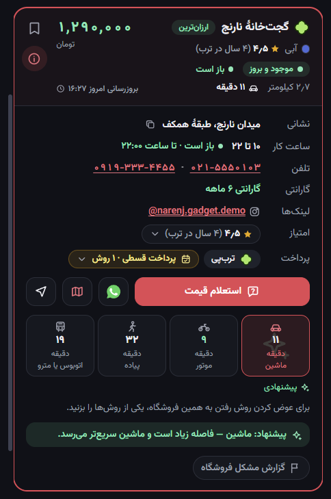
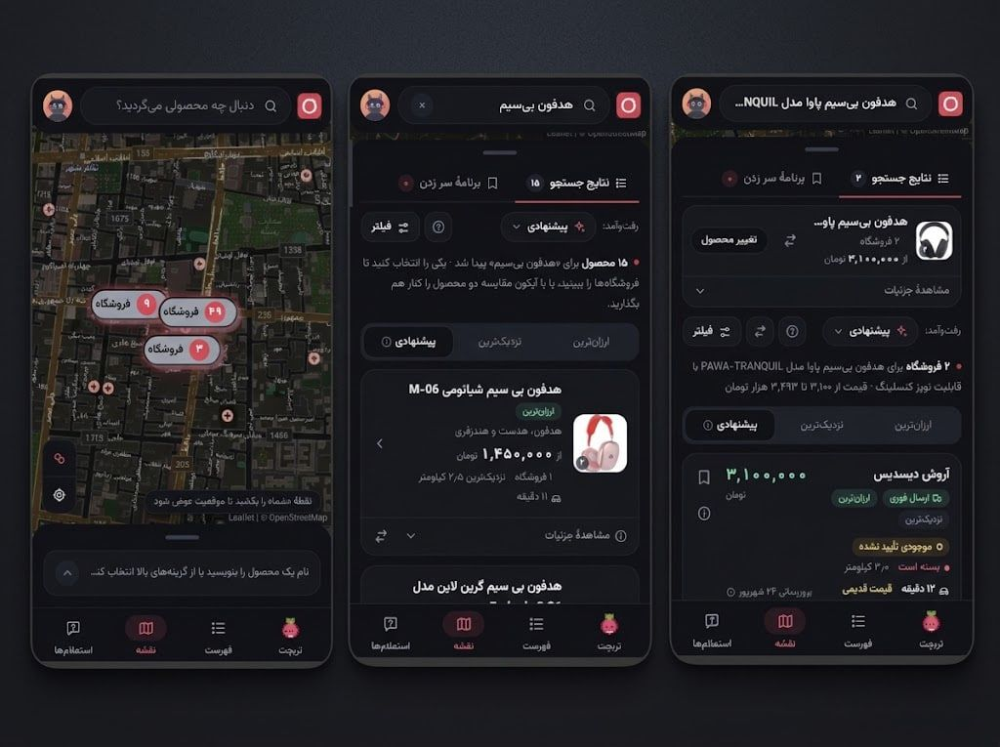
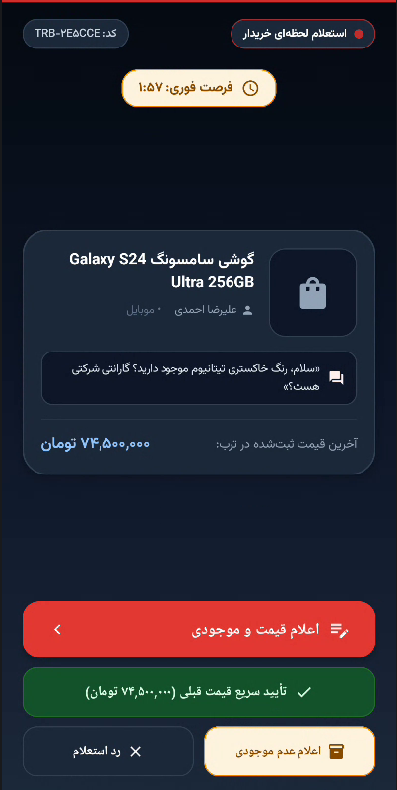
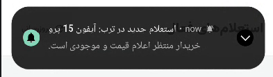
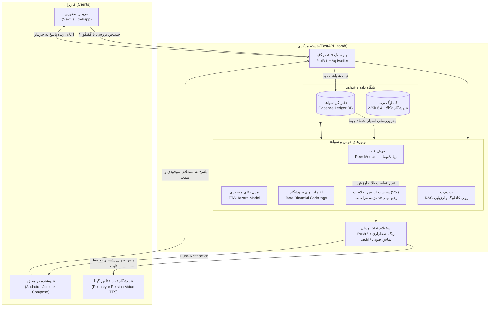

# ترب مپ · سامانه هوشمند خرید حضوری (TorobMap)
### Starcoach AI Hackathon — Unified Monorepo

<p align="center">
  <b>🌐 انتخاب زبان / Select Language:</b>
  <a href="README.md"><b> 🇮🇷 فارسی (پیش‌فرض)</b></a> |
  <a href="README_EN.md"><b> 🇬🇧 English</b></a>
</p>

[](https://fastapi.tiangolo.com)
[](https://nextjs.org)
[](https://developer.android.com/jetpack/compose)
[](https://duckdb.org)
[](#)

> **خلاصه ایده**: در خریدهای سنتی اینترنتی، پاسخ به سوال «کجا ارزان‌تر می‌فروشد؟» کافی است؛ اما برای خریدار حضوری در ترافیک شهر تهران، پاسخ به این سوال بسیار حیاتی‌تر و دشوارتر است:  
> **«اگر همین الان به این فروشگاه مراجعه کنم، آیا کالا با همین قیمت موجود است و آیا این فروشگاه قابل اعتماد است؟»**  
> 
> **ترب‌مپ (TorobMap)** با ترکیب یک موتور استنتاج احتمالاتی و شواهد-محور، چرخه استعلام بلادرنگ فروشندگان با زنگ اضطراری، اپلیکیشن بومی اندروید فروشنده با عملکرد پایدار آفلاین، وب‌اپلیکیشن تعاملی خریدار با نقشه زنده، و دستیار هوشمند ترب‌چت (TorobChat)، این چالش را حل می‌کند.

---

## 📸 گالری تصویری سامانه (Visual Showcase)

> کلیه تصاویر و اسکرین‌شات‌های سیستم در پوشه [`screenshots/`](screenshots/) نگهداری شده و شرح تفصیلی تمام المان‌ها در [کاتالوگ تصاویر](screenshots/README.md) درج شده است.

### ۱. وب‌اپلیکیشن خریدار (Customer Web App)

| دستیار هوشمند ترب‌چت و برنامه‌ریزی سرزدن‌ها | نمای دسکتاپ دوپَنِله نقشه و فروشگاه‌های فیزیکی ⭐ |
|:---:|:---:|
| [](docs/WEB_APP.md) | [](docs/WEB_APP.md) |
| *رابط کاربری خریدار، مشاوره RAG خرید و برنامه‌ریزی مسیر (`web-1.jpg`)* | *تلفیق نقشه تعاملی Leaflet با فیلتر قیمت و لیست مغازه‌ها (`web-3.png`)* |

| کارت مشخصات فروشگاه و راهنمای ترانزیت | مقایسه پهلوبه‌پهلو محصولات در بازار حضوری | برگه مشخصات فنی کامل کالا | نتایج جستجو و نقشه موبایل |
|:---:|:---:|:---:|:---:|
| [](docs/WEB_APP.md) | [](docs/WEB_APP.md) | [](docs/WEB_APP.md) | [](docs/WEB_APP.md) |
| *نشانی، ساعات کار، تلفن و پیشنهاد وسیله سفر (`web-4.png`)* | *مقایسه قیمت، فاصله و تعداد مغازه‌های موجود (`web-5.png`)* | *جستجو در مشخصات، استاندارد ضدآب و کدک‌ها (`web-6.png`)* | *مقایسه سریع قیمت و فاصله روی نقشه (`web-2.jpg`)* |

### ۲. اپلیکیشن موبایل فروشنده (Android Merchant App)

| زنگ اضطراری استعلام فوری ⭐ | تاریخچه و ردگیری استعلام‌ها | کارنامه عملکرد فروشگاه | دلیل ساختاریافته رد استعلام |
|:---:|:---:|:---:|:---:|
| [](docs/MERCHANT_APP.md) | [](docs/MERCHANT_APP.md) | [](docs/MERCHANT_APP.md) | [](docs/MERCHANT_APP.md) |
| *پنجره ۲ دقیقه‌ای تمام‌صفحه `URGENT_CALL`* | *پیگیری کدهای رهگیری TRB و قیمت‌ها* | *نرخ پاسخگویی و شاخص‌های SLA* | *ثبت شواهد برای مدل اعتماد بیزی* |

| ورود به پنل فروشندگان ترب | اعلان سیستمی اندروید | پوستر ترکیبی قابلیت‌های اپ فروشنده |
|:---:|:---:|:---:|
| [](docs/MERCHANT_APP.md) | [](docs/MERCHANT_APP.md) | [](docs/MERCHANT_APP.md) |
| *ورود با موبایل یا خط ثابت مغازه* | *نوتیفیکیشن شناور با اولویت بالا* | *نمای کامل اکوسیستم فروشنده* |

---

## 📚 ساختار اسناد و صفحات تخصصی (Documentation Map)

- 🏛️ [**معماری کلان و سیستم تصمیم‌گیری (docs/ARCHITECTURE.md)**](docs/ARCHITECTURE.md): تشریح جریان انتها-به-انتها داده، مدل‌های ریاضی و نردبان تشدید استعلام (SLA Ladder).
- 🌐 [**راهنمای وب‌اپلیکیشن خریدار (docs/WEB_APP.md)**](docs/WEB_APP.md): جزئیات رابط کاربری خریدار، Next.js 14، نقشه تعاملی Leaflet، دستیار RAG ترب‌چت و برنامه‌ریزی سرزدن‌ها.
- 📱 [**راهنمای اپلیکیشن اندروید فروشنده (docs/MERCHANT_APP.md)**](docs/MERCHANT_APP.md): راهنمای فنی اپلیکیشن Jetpack Compose، سرویس پیش‌زمینه زنگ اضطراری، صف آفلاین Room و تماس صوتی Poshteyar.
- 🧠 [**موتور هوش و بک‌اند مرکزی (docs/INTELLIGENCE_ENGINE.md)**](docs/INTELLIGENCE_ENGINE.md): فرمولاسیون مدل مخاطره بقای موجودی $S(t)$، میانه همتایان Leave-One-Out، به‌روزرسانی اعتماد بیزی و سیاست VoI.
- 🎬 [**راهنمای اسلایدهای ارائه هکاتون (docs/PRESENTATION.md)**](docs/PRESENTATION.md): دک ارائه ۱۷ اسلایدی تعاملی و خودکفا، ویدیوی همگام دو گوشی و سناریوی گفتار.
- 📸 [**کاتالوگ کامل تصاویر و اسکرین‌شات‌ها (screenshots/README.md)**](screenshots/README.md): جدول نگاشت تصاویر، بررسی تفصیلی هر اسکرین‌شات و راهنمای ثبت تصاویر جدید.
- 🚀 [**راهنمای راه‌اندازی و استقرار محلی و ابری (docs/DEPLOYMENT_GUIDE.md)**](docs/DEPLOYMENT_GUIDE.md): دستورالعمل گام‌به‌گام راه‌اندازی محلی با Docker/Node/Python و دیپلوی روی لیارا.

---

## 🗂️ اجزای ریپازیتوری (Repository Components)

| پوشه (Directory) | مؤلفه | استک و فناوری‌ها | نقش و وظیفه |
|---|---|---|---|
| [`torob/`](torob/) | **موتور هوش و بک‌اند مرکزی** | FastAPI · Python 3.11+ · DuckDB · SQLite WAL | هسته محاسباتی: ارزیابی معقولیت قیمت، تخمین بقای موجودی تا رسیدن خریدار، اعتماد چندبعدی فروشگاه با مدل بیزی، الگوریتم ارزش اطلاعات (VoI) و دستیار هوشمند ترب‌چت. |
| [`trobapp/`](trobapp/) | **وب‌اپلیکیشن مشتری** | Next.js 14 · React 18 · TypeScript · Leaflet | رابط کاربری خریدار: نقشه تعاملی فروشگاه‌های فیزیکی تهران، فیلتر و مقایسه هوشمند، گفتگوی طبیعی با ترب‌چت، بهینه‌سازی مسیر مراجعه حضوری و چرخه زنده استعلام. |
| [`torob_merchant_app/`](torob_merchant_app/) | **پلتفرم و اپلیکیشن اندروید فروشنده** | Kotlin · Jetpack Compose · Room DB · Poshteyar TTS | اپلیکیشن موبایل بومی مغازه‌داران: پنجره اضطراری ۲ دقیقه‌ای (`URGENT_CALL`) با شبیه‌سازی زنگ تلفن، پاسخ‌های سریع تک‌لمسی، صف آفلاین و پشتیبان صوتی تلفن ثابت. |
| [`presentation/`](presentation/) | **ارائه تعاملی و دموی هکاتون** | HTML5 · CSS3 / Tailwind · JavaScript · MP4 Assets | دک ارائهٔ ۱۷ اسلایدی آفلاین و خودکفا به همراه ویدیوی هم‌زمان دموی خریدار و فروشنده و سناریوی سخنرانی (`SCRIPT.md`). |
| [`screenshots/`](screenshots/) | **گالری و اسکرین‌شات‌های سامانه** | PNG · JPG · Markdown Catalog | کلیه تصاویر ثبت‌شده از اپلیکیشن اندروید و وب‌اپلیکیشن به همراه مستندات تفصیلی هر اسکرین‌شات. |
| [`trb-ui/`](trb-ui/) | **نمونه اولیه رابط کاربری** | HTML / CSS / Vanilla JS | مرجع و منبع حقیقت طراحی اولیه ظاهر و المان‌های تعاملی. |

---

## 🏛️ معماری کلان و جریان داده (Architecture Flow)



---

## 🚀 راهنمای سریع اجرا (Quick Start)

### ۱. اجرای وب‌اپلیکیشن مشتری (`trobapp`)
```bash
cd trobapp
npm install
npm run dev
```
👉 برنامه در آدرس **`http://localhost:3000`** در دسترس خواهد بود.

### ۲. اجرای بک‌اند مرکزی (`torob`)
```bash
cd torob
python3 -m venv .venv
source .venv/bin/activate
pip install -r requirements.txt
uvicorn torob.api.main:app --host 0.0.0.0 --port 8080 --reload
```
👉 درگاه API در **`http://localhost:8080`** و مستندات Swagger در **`http://localhost:8080/docs`**.

### ۳. بیلد نسخه اندروید فروشنده (`torob_merchant_app`)
```bash
cd torob_merchant_app/android
./gradlew assembleDebug
```
👉 فایل APK در مسیر `app/build/outputs/apk/debug/app-debug.apk` ساخته می‌شود.

### ۴. مشاهده اسلایدهای ارائه (`presentation`)
```bash
cd presentation && python3 -m http.server 8000
```
👉 مشاهده اسلایدها در مرورگر در آدرس **`http://localhost:8000`**.

---

## 🌐 پیوندهای استقرار آنلاین (Deployments)

- 📱 **وب‌اپلیکیشن مشتری (TrobApp)**: [https://torobmap.liara.run](https://torobmap.liara.run)
- ⚙️ **سرویس بک‌اند و هوش (Torob Intelligence API)**: [https://torobmap-api.liara.run](https://torobmap-api.liara.run)
- 📖 **مستندات تعاملی Swagger API**: [https://torobmap-api.liara.run/docs](https://torobmap-api.liara.run/docs)
- 🩺 **بررسی سلامت سامانه (Health Check)**: [https://torobmap-api.liara.run/api/v1/health](https://torobmap-api.liara.run/api/v1/health)
