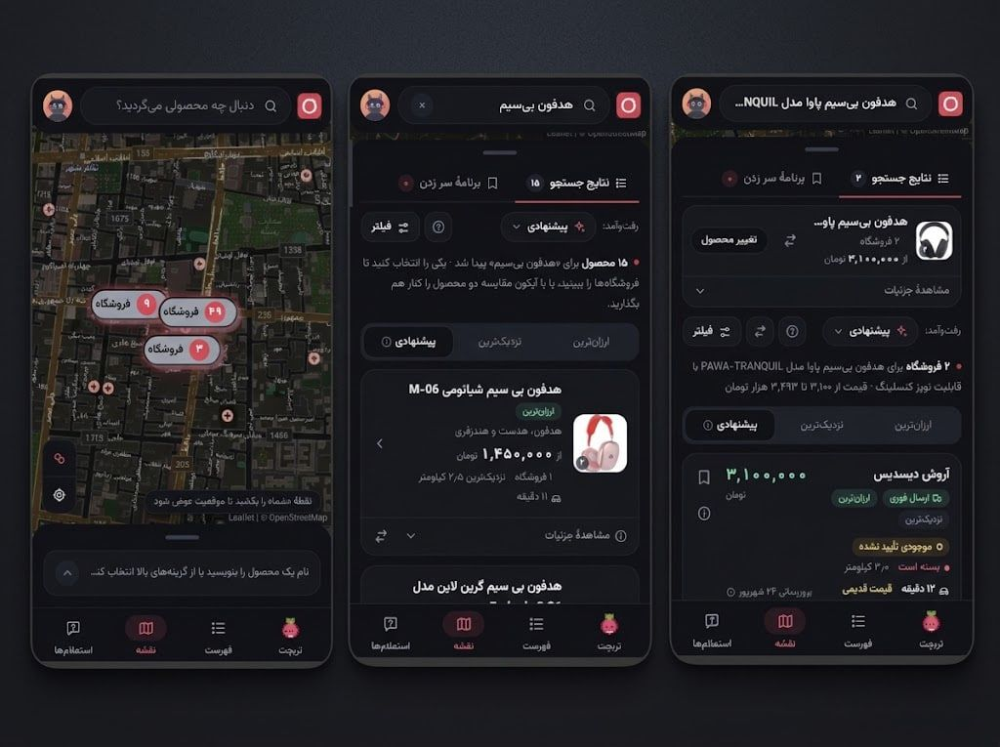
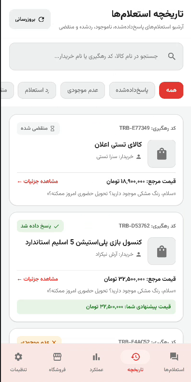
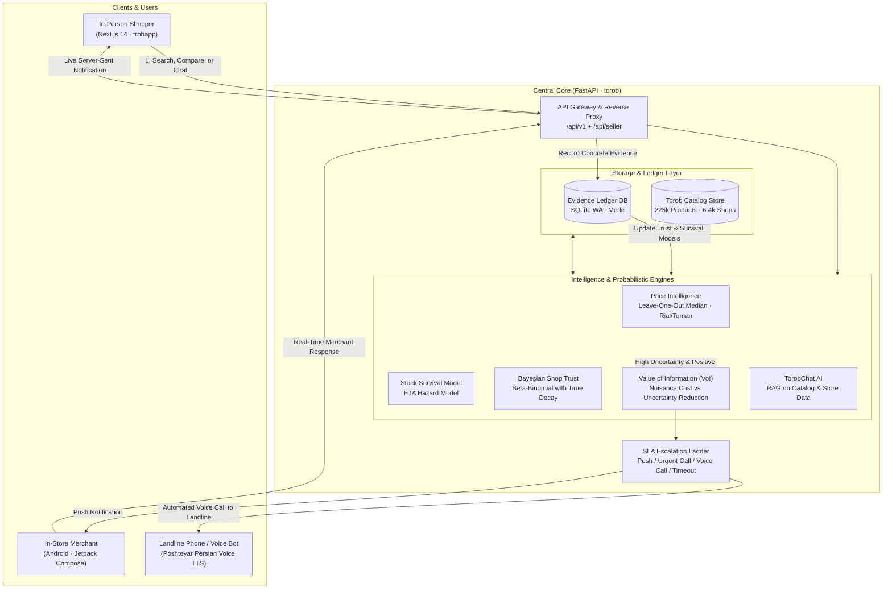

# TorobMap · Intelligent In-Person Shopping Platform
### Starcoach AI Hackathon — Unified Monorepo

<p align="center">
  <b>🌐 Select Language / انتخاب زبان:</b>
  <a href="README.md"><b> 🇮🇷 فارسی (Default)</b></a> |
  <a href="README_EN.md"><b> 🇬🇧 English</b></a>
</p>

[](https://fastapi.tiangolo.com)
[](https://nextjs.org)
[](https://developer.android.com/jetpack/compose)
[](https://duckdb.org)
[](#)

> **Executive Summary**: Traditional price-comparison platforms answer *"who sells cheapest online?"*. But an in-person shopper preparing to navigate city traffic needs a much harder question answered:  
> **"If I travel to this store right now, will the product still be in stock, at the stated price, and can this merchant be trusted?"**  
> 
> **TorobMap (ترب مپ)** solves this using an evidence-driven, probabilistic intelligence engine combined with real-time merchant inquiry routing, an offline-resilient Android merchant app with an urgent 2-minute call takeover, an interactive customer web experience with live Leaflet map routing, and an AI shopping assistant (TorobChat).

---

## 📸 Visual Showcase (Screenshots Gallery)

> All system screenshots are neatly cataloged in [`screenshots/`](screenshots/) with detailed technical walkthroughs in the [Screenshots Catalog](screenshots/README_EN.md).

### 1. Customer Web App (`trobapp`)

| TorobChat AI Assistant & Trip Planning | Desktop 2-Panel Map & Store Directory ⭐ |
|:---:|:---:|
| [](docs/WEB_APP_EN.md) | [](docs/WEB_APP_EN.md) |
| *Shopper interface, RAG chat assistant & store itinerary (`web-1.jpg`)* | *Interactive Leaflet map with price clusters & store cards (`web-3.png`)* |

| Store Details & Transit Recommendation | Side-by-Side Product Comparison Drawer | Full Technical Specification Sheet | Mobile Search & Map View |
|:---:|:---:|:---:|:---:|
| [](docs/WEB_APP_EN.md) | [](docs/WEB_APP_EN.md) | [](docs/WEB_APP_EN.md) | [](docs/WEB_APP_EN.md) |
| *Physical address, hours, phone & transit mode advice (`web-4.png`)* | *Market price, stock count & distance comparison (`web-5.png`)* | *Live spec search, IPX4 rating, latency & codecs (`web-6.png`)* | *Quick distance & price sorting on mobile (`web-2.jpg`)* |

### 2. Android Merchant App (`torob_merchant_app`)

| Urgent Inquiry Call Takeover ⭐ | Inquiry Lifecycle & History | Merchant Scorecard & Analytics | Structured Decline Reason Modal |
|:---:|:---:|:---:|:---:|
| [](docs/MERCHANT_APP_EN.md) | [](docs/MERCHANT_APP_EN.md) | [](docs/MERCHANT_APP_EN.md) | [](docs/MERCHANT_APP_EN.md) |
| *2-minute live countdown & call-style ring* | *Track TRB codes, prices & response states* | *Response rate (20% vs 85%) & average time* | *Structured feedback feeding Bayesian trust* |

| Merchant Login / Auth Screen | Android System Push Notification | Full Merchant App Poster |
|:---:|:---:|:---:|
| [](docs/MERCHANT_APP_EN.md) | [](docs/MERCHANT_APP_EN.md) | [](docs/MERCHANT_APP_EN.md) |
| *Mobile / landline OTP or one-tap dev login* | *High-priority foreground banner notification* | *Composite overview poster of mobile app* |

---

## 📚 Technical Documentation Map

For in-depth architectural and implementation details, explore the dedicated documentation modules:

- 🏛️ [**System Architecture & Decision Engine (docs/ARCHITECTURE_EN.md)**](docs/ARCHITECTURE_EN.md): End-to-end data flow, mathematical models, and SLA escalation ladder.
- 🌐 [**Customer Web App Guide (docs/WEB_APP_EN.md)**](docs/WEB_APP_EN.md): Next.js 14 App Router, Leaflet interactive map, TorobChat RAG assistant, and store visit planner.
- 📱 [**Android Merchant Platform (docs/MERCHANT_APP_EN.md)**](docs/MERCHANT_APP_EN.md): Jetpack Compose native app, `URGENT_CALL` foreground service, Room offline queue, and Poshteyar TTS landline backup.
- 🧠 [**Intelligence Engine & Backend (docs/INTELLIGENCE_ENGINE_EN.md)**](docs/INTELLIGENCE_ENGINE_EN.md): $S(t)$ ETA stock hazard model, Leave-One-Out peer median, Bayesian Beta-Binomial trust, and VoI dispatch policy.
- 🎬 [**Interactive Pitch Deck & Demo Guide (docs/PRESENTATION_EN.md)**](docs/PRESENTATION_EN.md): 17-slide standalone pitch deck, dual-phone synchronized demo video, and presentation script.
- 📸 [**Complete Screenshots Catalog (screenshots/README_EN.md)**](screenshots/README_EN.md): Image mapping table, technical screen analysis, and guide for adding new screenshots.
- 🚀 [**Local & Cloud Deployment Guide (docs/DEPLOYMENT_GUIDE_EN.md)**](docs/DEPLOYMENT_GUIDE_EN.md): Step-by-step instructions for running locally and deploying to Liara Cloud.

---

## 🗂️ Repository Components

| Directory | Component | Tech Stack | Role & Responsibility |
|---|---|---|---|
| [`torob/`](torob/) | **Central Intelligence Backend** | FastAPI · Python 3.11+ · DuckDB · SQLite WAL | Decision core: price reasonableness checks, stock arrival survival estimation, Bayesian store trust, VoI inquiry routing, and TorobChat RAG over 225k products and 6.4k stores. |
| [`trobapp/`](trobapp/) | **Customer Web Application** | Next.js 14 · React 18 · TypeScript · Leaflet | Shopper UI: live interactive Tehran map, price clustering, smart filters and comparison, natural conversation with TorobChat, in-person visit planning, and live inquiry tracking. |
| [`torob_merchant_app/`](torob_merchant_app/) | **Merchant Android Platform** | Kotlin · Jetpack Compose · Room DB · Poshteyar TTS | Native mobile app: 2-minute urgent call overlay (`URGENT_CALL`), one-tap responses, offline-first Room queue, and automated voice call backup for store landlines. |
| [`presentation/`](presentation/) | **Interactive Pitch Deck** | HTML5 · CSS3 / Tailwind · JavaScript · MP4 Assets | 17-slide self-contained presentation deck with synchronized customer-merchant inquiry demo video and complete speech script (`SCRIPT.md`). |
| [`screenshots/`](screenshots/) | **System Screenshots Catalog** | PNG · JPG · Markdown Documentation | High-resolution captures of the Android app and Web app with technical explanations and architectural links. |
| [`trb-ui/`](trb-ui/) | **UI Design Prototype** | HTML / CSS / Vanilla JS | Original UI design reference and styling source of truth. |

---

## 🏛️ High-Level System Architecture



---

## 🚀 Quick Start Guide

### 1. Run the Customer Web App (`trobapp`)
```bash
cd trobapp
npm install
npm run dev
```
👉 Application runs locally at **`http://localhost:3000`**.

### 2. Run the Intelligence Backend (`torob`)
```bash
cd torob
python3 -m venv .venv
source .venv/bin/activate
pip install -r requirements.txt
uvicorn torob.api.main:app --host 0.0.0.0 --port 8080 --reload
```
👉 API gateway at **`http://localhost:8080`** and Swagger docs at **`http://localhost:8080/docs`**.

### 3. Build the Merchant Android App (`torob_merchant_app`)
```bash
cd torob_merchant_app/android
./gradlew assembleDebug
```
👉 Output APK is generated at `app/build/outputs/apk/debug/app-debug.apk`.

### 4. View the Interactive Pitch Deck (`presentation`)
```bash
cd presentation && python3 -m http.server 8000
```
👉 Open browser at **`http://localhost:8000`**.

---

## 🌐 Live Cloud Deployments

- 📱 **Customer Web App (TrobApp)**: [https://torobmap.liara.run](https://torobmap.liara.run)
- ⚙️ **Intelligence Backend API**: [https://torobmap-api.liara.run](https://torobmap-api.liara.run)
- 📖 **Interactive Swagger Docs**: [https://torobmap-api.liara.run/docs](https://torobmap-api.liara.run/docs)
- 🩺 **System Health Check**: [https://torobmap-api.liara.run/api/v1/health](https://torobmap-api.liara.run/api/v1/health)
