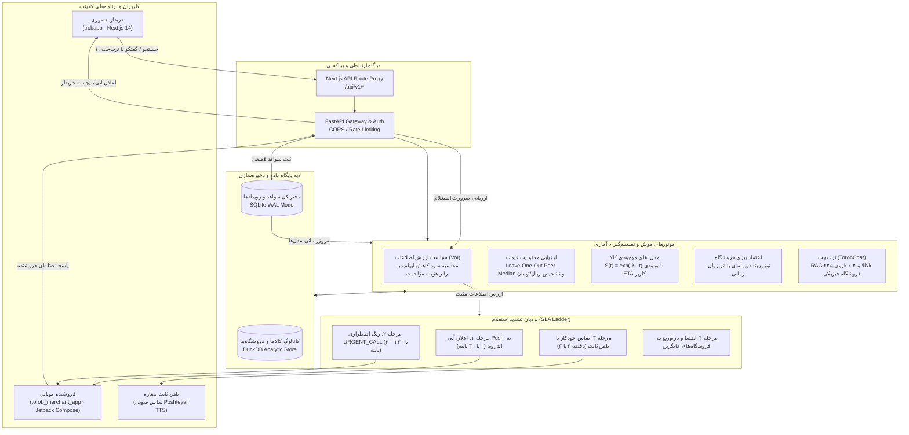

# 🏛️ معماری کلان و سیستم تصمیم‌گیری ترب‌مپ (System Architecture)

> این سند تشریح‌کنندهٔ معماری سیستم، جریان انتها-به-انتها داده‌ها، موتورهای استنتاج آماری، و نردبان تشدید تعهدات (SLA) در سامانه **ترب‌مپ (TorobMap)** است.

---

## ۱. نمای کلی سیستم و چرخه حیات استعلام

ترب‌مپ بر پایه این واقعیت بنا شده است که در خرید حضوری، هزینه مراجعه نادرست (ترافیک تهران، زمان هدر رفته، کالای ناموجود یا قیمت کاذب) بسیار سنگین است. بنابراین سیستم به جای نمایش قیمت‌های ایستا، از یک رویکرد **شواهد-محور (Evidence-Driven)** استفاده می‌کند:

---

## ۲. موتورهای استنتاج و الگوریتم‌های هوش مصنوعی

### الف) مدل معقولیت قیمت (Price Reasonableness)
برای جلوگیری از ثبت قیمت‌های اشتباه یا گمراه‌کننده (مثلاً ثبت نرخ به ریال به‌جای تومان):
- از میانه همتایان بدون خود فروشگاه (**Leave-One-Out Peer Median**) استفاده می‌شود.
- در صورتی که قیمت ثبت‌شده نسبت به میانه بازار مضرب یا کسری از توان‌های ۱۰ باشد، خطای واحد ریال/تومان به‌صورت خودکار تشخیص داده شده و هشدار داده می‌شود.

### ب) مدل بقای موجودی کالا (Stock Arrival Hazard Model)
احتمال اینکه کالا تا زمان رسیدن خریدار به فروشگاه همچنان در انبار موجود بماند طبق تابع بقا مدل‌سازی می‌شود:
$$S(t) = \exp(-\lambda \cdot t_{\text{ETA}})$$
که در آن:
- $t_{\text{ETA}}$ زمان تخمینی رسیدن خریدار با توجه به فاصله و ترافیک تهران است.
- $\lambda$ نرخ خروج یا ریسک اتمام کالا است که بر اساس محبوبیت کالا و رفتار تاریخی فروشگاه تعدیل می‌گردد.

### ج) مدل اعتماد بیزی فروشگاه (Bayesian Shop Trust Model)
امتیاز اعتماد هر فروشگاه بر اساس توزیع پسین بتا-دوپمله‌ای (**Beta-Binomial Conjugate**) با انقباض بیزی (Bayesian Shrinkage) به‌روز می‌شود:
- فروشگاه‌های جدید با توزیع پیشین محافظه‌کارانه شروع می‌کنند.
- هر پاسخ مثبت، رد مستند با دلیل مشخص، یا پاسخ سریع وزن مثبت می‌گیرد.
- انقضای مکرر استعلام‌ها یا عدم پاسخ‌گویی به تماس‌ها امتیاز اعتماد فروشگاه را کاهش داده و اولویت ارسال استعلام‌های آینده را به فروشندگان متعهدتر می‌دهد.

### د) سیاست ارزش اطلاعات (Value of Information - VoI)
ارسال نوتیفیکیشن یا تماس صوتی با فروشنده دارای هزینهٔ مزاحمت (**Nuisance Cost**) است. سیستم تنها زمانی استعلام جدید صادر می‌کند که:
$$\text{VoI} = \Delta \text{Certainty} \times \text{Transaction Value} - \text{Interruption Cost} > 0$$
برای کالاهای ارزان‌قیمت سوپرمارکتی استعلام فرستاده نمی‌شود، اما برای کالاهای گران‌قیمت یا کالاهایی با موجودی حساس، استعلام در اولویت بالا قرار می‌گیرد.

---

## ۳. نردبان تشدید استعلام (SLA Ladder)

پاسخ‌گویی به خریدار بر پایه ۴ مرحله با زمان‌بندی دقیق طراحی شده است:

1. **۰ تا ۳۰ ثانیه (Normal Push)**: ارسال نوتیفیکیشن بی‌صدا یا کم‌صدا به گوشی فروشنده.
2. **۳۰ تا ۱۲۰ ثانیه (Urgent Call Takeover)**: فعال‌سازی سرویس پیش‌زمینه اندروید با زنگ ممتد تماس و ویبره مشابه تماس تلفنی ورودی (`androidapp-4.png`).
3. **۱۲۰ تا ۱۸۰ ثانیه (Voice Fallback)**: در صورت عدم پاسخ فروشنده به اپلیکیشن، سرویس تلفن گویای پشت‌یار (Poshteyar TTS) به‌صورت خودکار با تلفن ثابت فروشگاه تماس گرفته و پیام صوتی استعلام را قرائت می‌کند.
4. **پس از ۳ دقیقه (Timeout & Fallback)**: استعلام منقضی شده، خریدار از وضعیت مطلع گشته و فروشگاه‌های جایگزین به او پیشنهاد داده می‌شوند.

---

## ۴. لینک‌های مرتبط

- 🌐 [راهنمای وب‌اپلیکیشن خریدار](WEB_APP.md)
- 📱 [راهنمای اپلیکیشن اندروید فروشنده](MERCHANT_APP.md)
- 🧠 [راهنمای موتور هوش و بک‌اند](INTELLIGENCE_ENGINE.md)
- 📸 [کاتالوگ تصاویر و اسکرین‌شات‌ها](../screenshots/README.md)
