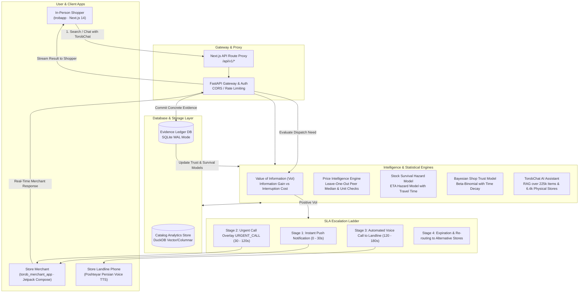

# 🏛️ System Architecture & Decision Engine (TorobMap)

<p align="center">
  <b>🌐 Language / زبان:</b>
  <a href="ARCHITECTURE.md"><b> 🇮🇷 فارسی</b></a> |
  <a href="ARCHITECTURE_EN.md"><b> 🇬🇧 English (Current)</b></a>
</p>

---

> This document describes the system architecture, end-to-end data flow, probabilistic inference engines, and SLA escalation ladder of the **TorobMap** platform.

---

## 1. System Overview & Inquiry Lifecycle

TorobMap addresses the high cost of failed in-person shopping trips (Tehran traffic congestion, wasted travel time, out-of-stock items, or outdated prices). Instead of relying on static scraped prices, the system uses an **evidence-driven probabilistic framework**:



---

## 2. Statistical Inference Engines & Mathematical Formulations

### A) Price Reasonableness & Unit Discrepancy Detection
To evaluate a store's listed price without introducing self-bias, the system computes the **Leave-One-Out Peer Median**:

```math
\tilde{P}_{-i} = \operatorname{Median}\left(\{P_j : j \in \mathcal{S}_{\mathrm{peer}}, j \neq i\}\right)
```

- If $|P_i - \tilde{P}\_{-i}| \approx 9 \times P_i$ or $P_i / \tilde{P}\_{-i} \in [9.5, 10.5]$ or $[0.095, 0.105]$, an automated Rial-versus-Toman 10x denomination error is flagged.

### B) Stock Arrival Hazard Model
In-person shopping involves transit time. The probability that an item remains in stock upon customer arrival is modeled as an exponential survival function:

```math
S(t_{\mathrm{ETA}}) = \exp(-\lambda \cdot t_{\mathrm{ETA}})
```

Where:
- $t\_{\mathrm{ETA}}$ is the estimated travel time in minutes based on real-time city transit patterns.
- $\lambda$ is the store departure rate, factoring in item popularity and historical store sales velocity:

```math
\lambda = \lambda_0 \cdot \gamma_{\mathrm{popularity}} \cdot \gamma_{\mathrm{store\_velocity}}
```

### C) Bayesian Shop Trust Model
A merchant's reliability $\theta$ is modeled with a conjugate Beta-Binomial distribution with prior $\operatorname{Beta}(\alpha\_0, \beta\_0)$ and Bayesian shrinkage:

```math
\alpha_{\mathrm{new}} = \alpha_{\mathrm{old}} \cdot e^{-\Delta t / \tau} + k
```

```math
\beta_{\mathrm{new}} = \beta_{\mathrm{old}} \cdot e^{-\Delta t / \tau} + (n - k)
```

```math
\hat{\theta} = \frac{\alpha_{\mathrm{new}}}{\alpha_{\mathrm{new}} + \beta_{\mathrm{new}}}
```

The parameter $e^{-\Delta t / \tau}$ applies a time decay, giving higher weight to recent merchant interactions.

### D) Value of Information (VoI) Inquiry Policy
Dispatching notifications or voice calls incurs a nuisance cost. An inquiry is only dispatched if the expected uncertainty reduction outweighs the interruption cost:

```math
\mathrm{VoI} = \Delta \mathrm{Certainty} \times \mathrm{TransactionValue} - \mathrm{InterruptionCost} > 0
```

---

## 3. SLA Escalation Ladder

1. **0 – 30s (Silent Push)**: Standard background push notification to merchant app.
2. **30 – 120s (Urgent Call Takeover)**: Android foreground service activates an incoming-call screen overlay with continuous ringtone (`androidapp-4.png`).
3. **120 – 180s (Voice Fallback)**: Automated Persian speech synthesis bot (Poshteyar TTS) places a voice call to the physical store's landline phone.
4. **Post 180s (Expiration)**: Inquiry expires gracefully; the shopper is notified and offered alternative nearby stores.

---

## 4. Related Documentation

- 🌐 [Shopper Web App Guide (WEB_APP_EN.md)](WEB_APP_EN.md)
- 📱 [Merchant Android Platform (MERCHANT_APP_EN.md)](MERCHANT_APP_EN.md)
- 🧠 [Intelligence Backend (INTELLIGENCE_ENGINE_EN.md)](INTELLIGENCE_ENGINE_EN.md)
- 📸 [Screenshots Catalog (screenshots/README_EN.md)](../screenshots/README_EN.md)
