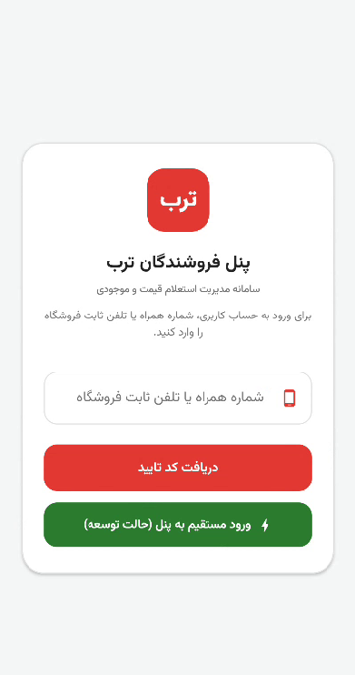
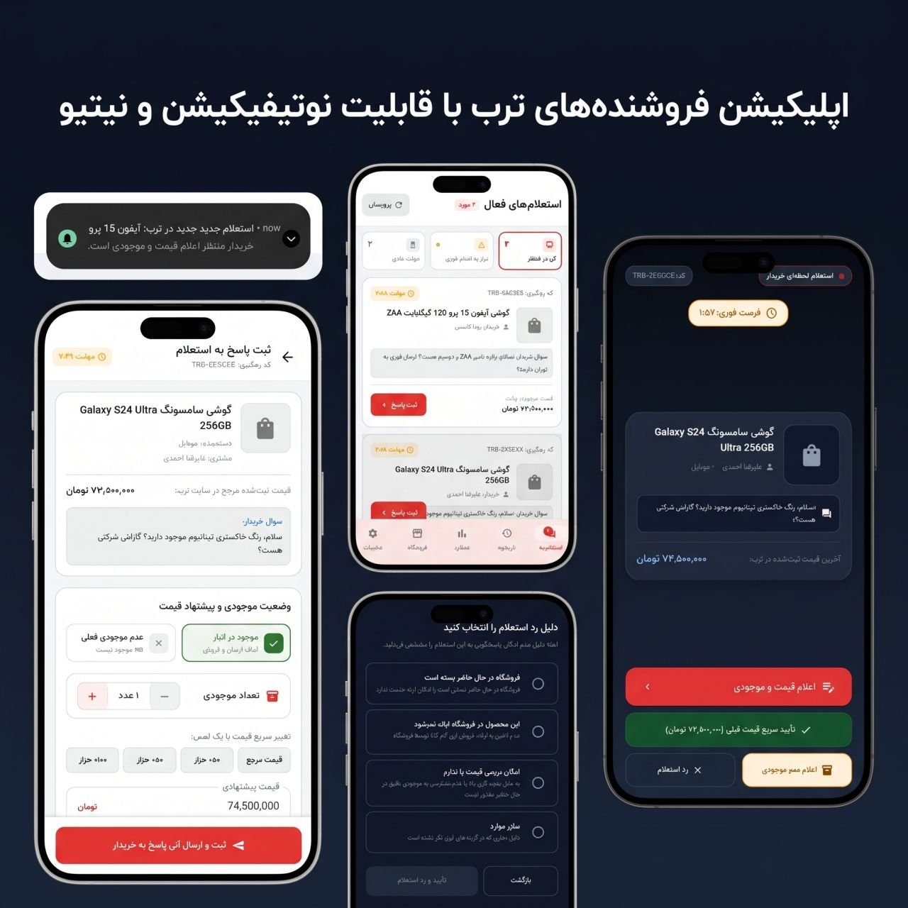

# 📱 Merchant Platform & Android Mobile App Guide

<p align="center">
  <b>🌐 Language / زبان:</b>
  <a href="MERCHANT_APP.md"><b> 🇮🇷 فارسی</b></a> |
  <a href="MERCHANT_APP_EN.md"><b> 🇬🇧 English (Current)</b></a>
</p>

---

> This document details the software architecture, interactive workflows, foreground call service, and offline resilience of the [`torob_merchant_app/`](../torob_merchant_app/) Android native application.

---

## 1. Visual Showcase

| Urgent Call Overlay ⭐ | Inquiry Lifecycle & History | Merchant Scorecard & Analytics | Structured Decline Reason Modal |
|:---:|:---:|:---:|:---:|
| [](../screenshots/androidapp-4.png) | [](../screenshots/androidapp-2.png) | [](../screenshots/androidapp-3.png) | [](../screenshots/androidapp-5.png) |
| *2-minute live countdown & call-style ring (`androidapp-4.png`)* | *Track TRB codes, prices & states (`androidapp-2.png`)* | *Response rate (20% vs 85%) & speed (`androidapp-3.png`)* | *Structured feedback for Bayesian trust (`androidapp-5.png`)* |

| Merchant Login / Auth Screen | Android System Push Notification | Full Merchant App Poster |
|:---:|:---:|:---:|
| [](../screenshots/androidapp-1.png) | [](../screenshots/androidapp-6.png) | [](../screenshots/androidapp-7.jpg) |
| *Mobile / landline OTP or one-tap dev login (`androidapp-1.png`)* | *High-priority foreground banner (`androidapp-6.png`)* | *Composite overview poster of mobile app (`androidapp-7.jpg`)* |

---

## 2. Technical Stack

- **Target OS**: Android (Min SDK 26 · Target SDK 34)
- **Language & UI**: Modern Kotlin with **Jetpack Compose**
- **State Management**: Jetpack ViewModel · StateFlow / SharedFlow · Navigation Compose
- **Local Persistence**: **Room Database** (SQLite) for offline action queues and idempotent state sync
- **Networking**: Retrofit 2 · OkHttp 3 · Kotlinx Serialization
- **Foreground Service**: Dedicated `UrgentCallService` managing continuous ringtone and lock-screen wake-up
- **Automated Voice Backup**: Integration with **Poshteyar TTS** placing automated Persian voice calls to store landlines

---

## 3. Core Architectural Highlights

### A) 2-Minute Urgent Call Takeover (`URGENT_CALL`)
When an in-person shopper requests verification:
1. The app triggers a high-priority foreground service waking the phone screen even from locked mode.
2. An urgent 2-minute live countdown SLA timer begins.
3. The merchant responds via three one-tap buttons:
   - **Quickly Confirm Previous Price**: Instant verification with 1 tap.
   - **Declare Price & Stock**: Sliders for price adjustments and exact quantity.
   - **Decline Inquiry**: Structured refusal dialog.

### B) Structured Rejections as Evidence
Rather than silently ignoring inquiries, merchants select structured reasons (store currently closed, item discontinued, price cannot be verified, invalid request). These are converted into Bayesian evidence.

---

## 4. Gradle Build Instructions

```bash
cd torob_merchant_app/android
./gradlew assembleDebug
```
Output APK: `app/build/outputs/apk/debug/app-debug.apk`
