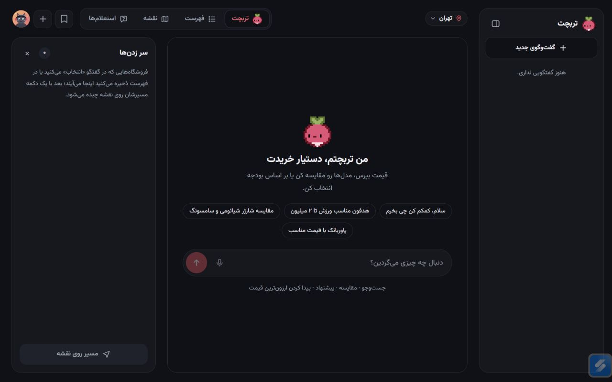
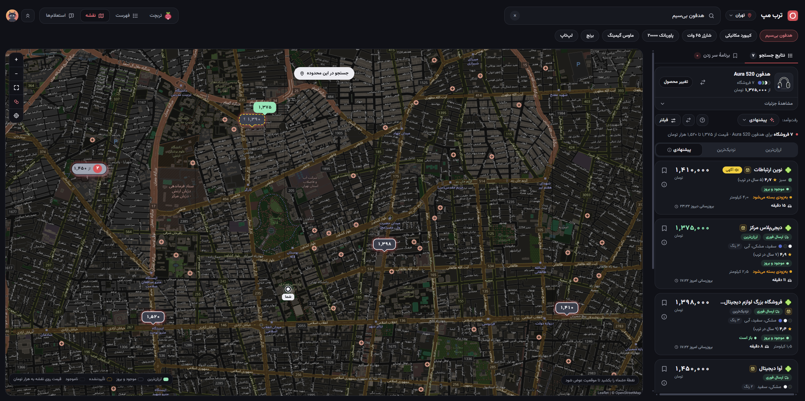

# 🌐 Shopper Web Application Guide (`trobapp`)

<p align="center">
  <b>🌐 Language / زبان:</b>
  <a href="WEB_APP.md"><b> 🇮🇷 فارسی</b></a> |
  <a href="WEB_APP_EN.md"><b> 🇬🇧 English (Current)</b></a>
</p>

---

> This document details the frontend architecture, interactive Leaflet map integration, TorobChat AI assistant, and store visit planning capabilities of [`trobapp/`](../trobapp/).

---

## 1. Visual Interface Gallery

### A) Desktop Views & TorobChat AI

| TorobChat AI Shopping Assistant & Itinerary | Desktop 2-Panel Live Map & Store Directory ⭐ |
|:---:|:---:|
| [](../screenshots/web-1.jpg) | [](../screenshots/web-3.png) |
| *Conversational in-person shopping consultation (`web-1.jpg`)* | *Interactive Leaflet map with price clusters & store cards (`web-3.png`)* |

### B) Physical Store Discovery, Transit Advice, Comparison & Specs

| Store Details & Transit Guidance | Side-by-Side Product Comparison Drawer | Full Technical Specification Sheet |
|:---:|:---:|:---:|
| [](../screenshots/web-4.png) | [](../screenshots/web-5.png) | [](../screenshots/web-6.png) |
| *Physical address, hours, phone & transit advice (`web-4.png`)* | *Market price, stock count & distance comparison (`web-5.png`)* | *Live spec search, IPX4 rating, latency & codecs (`web-6.png`)* |

---

## 2. Technical Stack

- **Framework**: [Next.js 14](https://nextjs.org/) App Router
- **Core Libraries**: React 18.3, Leaflet 1.9.4, Lucide Icons, TypeScript
- **Rendering Pattern**: Hybrid SSR with client-side interactive modules (`'use client'`)
- **API Gateway Proxy**: Dynamic reverse proxy in `src/app/api/v1/[...path]/route.ts` routing requests cleanly to FastAPI without CORS issues

---

## 3. Core Capabilities

### A) TorobChat AI Shopping Assistant
- Context-aware Persian conversational shopping assistant powered by RAG on 225k products and 6.4k physical stores.
- Identifies user intent, budget limits, brand preferences, and in-person purchase urgency.
- Seamlessly transfers recommendations to the user's map route planner.

### B) Desktop 2-Panel Map & Store Directory (`web-3.png`)
- Leaflet interactive map with custom price clustering.
- Quick search chips (Mechanical Keyboard, 25W Samsung Charger, Gaming Mouse, etc.).
- Multi-criteria sorting: Cheapest, Nearest, and Algorithmic Recommendation.
- Live travel time (ETA) and store inventory status.

### C) Store Details & Transit Advice (`web-4.png`)
- Comprehensive physical store verification: exact address, business hours, landline/mobile contacts, Torob merchant tenure, and star ratings.
- Intelligent transit recommendations: calculates travel friction and suggests car vs public transit to maximize stock arrival probability.
- Payment methods: TorobPay, installment plans, and in-store settlement.

### D) In-Person Physical Market Comparison (`web-5.png`)
- Side-by-side comparison of up to 5 models evaluated by in-person market metrics: lowest physical price, number of stocked stores in Tehran, nearest store distance, and battery longevity.

### E) In-Modal Specification Search (`web-6.png`)
- Hardware specification sheet with instantaneous keyword search (IPX4 rating, earbud weight, audio codecs, low-latency gaming mode).

---

## 4. Local Development

```bash
cd trobapp
npm install
npm run dev
```
Available at: `http://localhost:3000`
