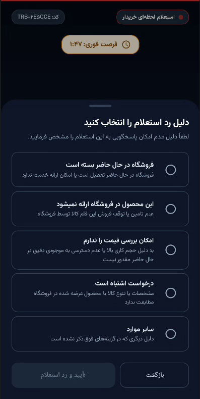
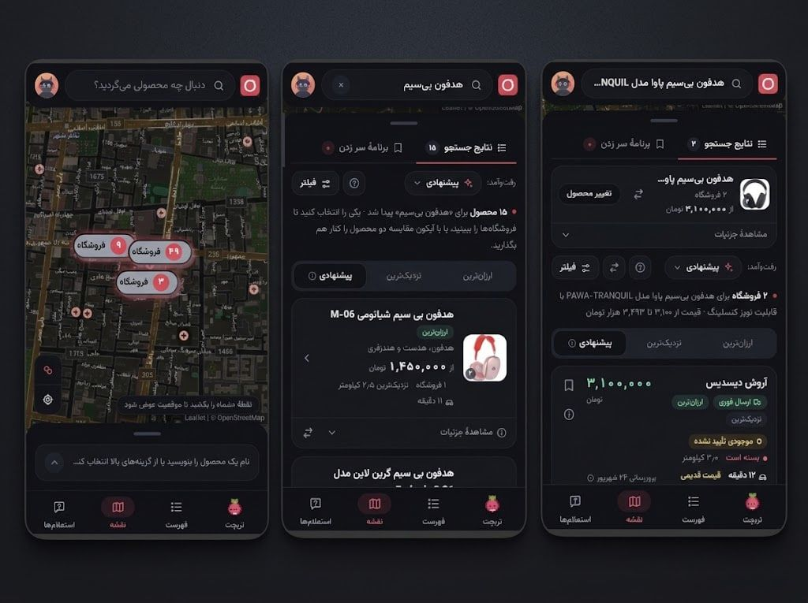
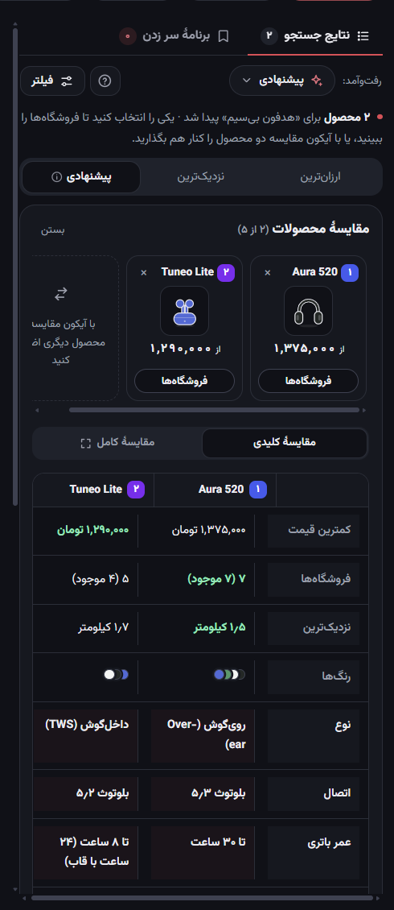

# 📸 راهنمای جامع تصاویر و اسکرین‌شات‌های سامانه ترب‌مپ (TorobMap Screenshots Catalog)

این پوشه شامل تصاویر و اسکرین‌شات‌های ثبت‌شده از بخش‌های مختلف سامانه **ترب‌مپ (TorobMap)** است که شامل وب‌اپلیکیشن مشتری (`trobapp`) و اپلیکیشن اندروید فروشندگان (`torob_merchant_app`) می‌باشد.

---

## 📑 فهرست تصاویر و نگاشت به مؤلفه‌ها

| نام فایل | مؤلفه مربوطه | پلتفرم / ابعاد | عنوان صفحه / قابلیت | نقش در سامانه |
|---|---|---|---|---|
| [`androidapp-1.png`](androidapp-1.png) | `torob_merchant_app` | Android (391×742) | ورود و احراز هویت فروشنده | ورود با شماره همراه / خط ثابت مغازه یا ورود مستقیم تستی |
| [`androidapp-2.png`](androidapp-2.png) | `torob_merchant_app` | Android (395×789) | تاریخچه استعلام‌های خریداران | پیگیری کدهای رهگیری `TRB-...`، وضعیت استعلام و قیمت‌ها |
| [`androidapp-3.png`](androidapp-3.png) | `torob_merchant_app` | Android (395×789) | کارنامه عملکرد و شاخص‌های SLA | نرخ پاسخ‌گویی، میانگین زمان پاسخ و راهنمای رتبه در ترب |
| [`androidapp-4.png`](androidapp-4.png) | `torob_merchant_app` | Android (397×790) | هشدار اضطراری استعلام فوری ⭐ | پنجره تمام‌صفحه تماس ورودی (`URGENT_CALL`) با تایمر ۲ دقیقه‌ای |
| [`androidapp-5.png`](androidapp-5.png) | `torob_merchant_app` | Android (397×790) | انتخاب دلیل رد استعلام | ثبت دلیل ساختاریافته برای مدل اعتماد بیزی و بقای موجودی |
| [`androidapp-6.png`](androidapp-6.png) | `torob_merchant_app` | Android (393×111) | اعلان شناور در نوار وضعیت | نوتیفیکیشن لحظه‌ای با اولویت بالا در سطح سیستم اندروید |
| [`androidapp-7.jpg`](androidapp-7.jpg) | `torob_merchant_app` | پوستر (1280×1280) | نمای کلی اکوسیستم فروشنده | پوستر نمایش یکپارچه قابلیت‌های کلیدی اپ فروشنده |
| [`web-1.jpg`](web-1.jpg) | `trobapp` | Web (1280×800) | صفحه اصلی و دستیار هوشمند ترب‌چت | گفتگوی هوشمند RAG خرید حضوری، پرامپت‌ها و برنامه سرزدن‌ها |
| [`web-2.jpg`](web-2.jpg) | `trobapp` | Web (1024×765) | نتایج جستجو، نقشه و مقایسه | مقایسه قیمت و فاصله فروشگاه‌های تهران، فیلترها و مسیریابی |
| [`web-3.png`](web-3.png) | `trobapp` | Web Desktop (2538×1267) | نمای دسکتاپ دوپَنِله نقشه و فروشگاه‌ها ⭐ | نقشه زنده تهران، لیست فروشگاه‌های فیزیکی، فیلتر قیمت و فاصله |
| [`web-4.png`](web-4.png) | `trobapp` | Web Mobile (484×729) | کارت مشخصات فروشگاه و راهنمای رفت‌وآمد | نشانی فیزیکی، ساعات کاری، شماره تماس، گارانتی و پیشنهاد وسیله سفر |
| [`web-5.png`](web-5.png) | `trobapp` | Web Mobile (490×1130) | مقایسه پهلوبه‌پهلو محصولات خرید حضوری | ماتریس مقایسه قیمت، فاصله نزدیک‌ترین فروشگاه و مشخصات فیزیکی |
| [`web-6.png`](web-6.png) | `trobapp` | Web Modal (734×884) | مشخصات فنی کامل کالا با جستجو | نمایش ریز مشخصات سخت‌افزاری، کدک‌ها، باتری، وزن و استاندارد ضدآب |

---

## 📱 جزئیات اسکرین‌شات‌های اپلیکیشن فروشنده (Merchant App)

### ۱. ورود و احراز هویت (`androidapp-1.png`)

- **شرح صفحه**: صفحه ورود به سامانه مدیریت استعلام قیمت و موجودی فروشندگان ترب.
- **امکانات برجسته**:
  - فیلد دریافت شماره همراه یا تلفن ثابت فروشگاه (در صورت ثبت شماره ثابت، کد ورود از طریق تماس صوتی خودکار سرویس پشتیبان Poshteyar خوانده می‌شود).
  - دکمه میان‌بر «ورود مستقیم به پنل (حالت توسعه)» برای تسهیل تست‌های محلی و داوری هکاتون.

---

### ۲. تاریخچه استعلام‌ها و ردگیری (`androidapp-2.png`)

- **شرح صفحه**: فهرست کامل استعلام‌های خریداران در وضعیت‌های منقضی‌شده، پاسخ‌داده‌شده، ناموجود و رد شده.
- **امکانات برجسته**:
  - کدهای رهگیری یکتا مانند `TRB-E77249` و `TRB-D53762`.
  - نمایش کالای مورد استعلام (مثل کنسول بازی PS5 اسلیم، کالاهای دیجیتال و غیره).
  - تفکیک قیمت مرجع ترب و قیمت پیشنهادی فروشنده به همراه یادداشت ارسالی خریدار.
  - نوار جستجوی کالا، فیلتر وضعیت و دکمه به‌روزرسانی زنده.

---

### ۳. شاخص‌های عملکرد و کارنامه فروشگاه (`androidapp-3.png`)

- **شرح صفحه**: داشبورد تحلیلی و مانیتورینگ تعهدات فروشنده (SLA) در پاسخ‌گویی به خریداران.
- **امکانات برجسته**:
  - نمایش شاخص کلی عملکرد فروشگاه («نیازمند بهبود»).
  - **نرخ پاسخ‌گویی**: محاسبه نسبت استعلام‌های پاسخ‌داده‌شده به کل (۲۰٪ با هدف ۸۵٪).
  - **میانگین زمان پاسخ**: ثبت دقیق مدت زمان پاسخ‌دهی (۱ دقیقه و ۹ ثانیه با هدف کمتر از ۵ دقیقه).
  - تفکیک نموداری وضعیت استعلام‌ها (پاسخ‌داده‌شده، بی‌پاسخ، منقضی‌شده).
  - بخش آموزشی و انگیزشی: راهنمای ارتقای رتبه فروشگاه در الگوریتم ترب‌مپ.

---

### ۴. هشدار اضطراری تمام‌صفحه استعلام لحظه‌ای خریدار (`androidapp-4.png`) ⭐

- **شرح صفحه**: صفحه تماس شبیه‌سازی‌شده (Hero Screen / Urgent Call Takeover) که هستهٔ تعاملی ایده ترب‌مپ است.
- **امکانات برجسته**:
  - پخش زنگ ممتد و ویبره حتی در صورت قفل بودن صفحه با Foreground Service بومی اندروید.
  - تایمر زندهٔ فرصت فوری (SLA ۲ دقیقه‌ای).
  - نمایش اطلاعات کامل استعلام: کالا (Galaxy S24 Ultra)، نام خریدار (علیرضا احمدی)، پیام اختصاصی و آخرین قیمت مرجع ترب.
  - سه اقدام تک‌لمسی: «اعلام قیمت و موجودی»، «تأیید سریع قیمت قبلی» و «رد استعلام».

---

### ۵. انتخاب دلیل رد استعلام برای مدل اعتماد بیزی (`androidapp-5.png`)

- **شرح صفحه**: کادر محاوره‌ای الزامی برای ثبت دلیل رد استعلام توسط فروشنده.
- **امکانات برجسته**:
  - گزینه‌های ساختاریافته: تعطیلی فروشگاه، عدم عرضه کالا، عدم امکان بررسی قیمت، مغایرت درخواست و سایر موارد.
  - **نقش در معماری بک‌اند**: انتقال مستقیم داده‌ها به موتور اعتماد بیزی (Beta-Binomial) و مدل بقای موجودی (ETA Hazard Model).

---

### ۶. اعلان سیستم اندروید (`androidapp-6.png`)

- **شرح تصویر**: اعلان با اولویت بالا (High Priority Heads-Up Push Notification) در نوار اعلان‌های اندروید با پیام استعلام جدید آیفون 15 پرو.

---

### ۷. پوستر جامع اپلیکیشن فروشنده (`androidapp-7.jpg`)

- **شرح تصویر**: پوستر تلفیقی از صفحات کلیدی اپلیکیشن اندروید فروشنده شامل زنگ تماس ورودی، فرم ثبت قیمت و موجودی، دلایل رد و نوتیفیکیشن.

---

## 🌐 جزئیات اسکرین‌شات‌های وب‌اپلیکیشن خریدار (Shopper Web App)

### ۱. صفحه اصلی، دستیار هوشمند ترب‌چت و برنامه‌ریزی سرزدن‌ها (`web-1.jpg`)

- **شرح صفحه**: نمای دسکتاپ و رابط کاربری وب مشتریان (`trobapp`).
- **امکانات برجسته**:
  - نوار بالایی با انتخاب موقعیت مکانی (تهران)، مدیریت استعلام‌ها و جستجو.
  - **ترب‌چت (دستیار هوشمند خرید)**: موتور جستجو و مشاوره خرید مبتنی بر RAG روی کاتالوگ ۲۲۵ هزار کالا و ۶۴۰۰ فروشگاه فیزیکی.
  - نمونه پرسش‌های آماده و پنل سازمان‌دهی «سر زدن‌ها» برای چیدن مسیر بهینه مراجعه.

---

### ۲. نتایج جستجو، مقایسه قیمت و نقشه فروشگاه‌ها (`web-2.jpg`)

- **شرح صفحه**: نمایش نتایج جستجوی خرید حضوری با مقایسه فروشگاه‌ها و پین‌های نقشه Leaflet.
- **امکانات برجسته**:
  - کارت‌های اختصاصی فروشگاه‌های فیزیکی تهران، فاصله دقیق تا کاربر، ETA، وضعیت باز/بسته بودن و دکمه‌های استعلام.

---

### ۳. نمای دسکتاپ دوپَنِله نقشه زنده و لیست فروشگاه‌های فیزیکی (`web-3.png`) ⭐

- **شرح صفحه**: نمای عریض دسکتاپ (۲۵۳۸×۱۲۶۷) شامل تلفیق نقشه تعاملی شهر تهران با خوشه‌بندی قیمت‌ها در پَنِل سمت راست، و کارت‌های عمیق فروشگاه‌ها در پَنِل سمت چپ.
- **امکانات برجسته**:
  - چیپ‌های دسترسی سریع جستجو: «کیبورد مکانیکی»، «شارژر ۲۵ وات سامسونگ»، «موس گیمینگ»، «برچسب لپتاپ».
  - اطلاعات تجمیعی کالا: «هدفون Aura 520 - قیمت از ۱,۳۷۵ تا ۱,۵۲۰ هزار تومان» با ۷ فروشگاه فیزیکی در تهران.
  - مرتب‌سازی چندمعیاره: **ارزان‌ترین**، **نزدیک‌ترین**، و **پیشنهادی**.
  - برچسب‌های اطمینان: «موجود و بروز»، «به‌زودی بسته می‌شود»، فاصله مکانی و زمان سفر (مثلاً ۲.۵ کیلومتر / ۱۱ دقیقه)، به همراه تنوع رنگی انبار مغازه (سفید، مشکی، آبی).

---

### ۴. کارت مشخصات فروشگاه و راهنمای رفت‌وآمد (`web-4.png`)

- **شرح صفحه**: کارت کشویی اختصاصی فروشگاه فیزیکی با کلیه شواهد و راه‌های ارتباطی معتبر.
- **امکانات برجسته**:
  - **هویت فروشگاه**: «گجت‌خانه نارنج» با سابقه ۴ سال حضور در ترب و امتیاز ۴.۵ ستاره.
  - **اطلاعات مکانی و زمانی**: نشانی دقیق فیزیکی (میدان نارنج، طبقه همکف)، ساعت کاری دقیق (۱۰ تا ۲۲)، فاصله ۷ کیلومتر / ۱۱ دقیقه.
  - **کانال‌های تماس تایید‌شده**: تلفن ثابت دفتر (`۰۲۱-۵۵۵۰۱۰۳۴`) و همراه مغازه‌دار (`۰۹۱۹-۳۳۳-۴۴۵۵`) و شناسه اینستاگرام.
  - **گارانتی و روش‌های تسویه**: تضمین ۶ ماهه، تسویه با ترب‌پی (TorobPay)، خرید اقساطی و ۱۰ شیوه پرداخت حضوری.
  - **راهنمای هوشمند ترانزیت**: ارزیابی مسیر و پیشنهاد وسیله سفر («پیشنهاد: ماشین — فاصله زیاد است و ماشین سریع‌تر می‌رسد»).
  - دکمه گزارش مشکل و تخلف فروشگاه.

---

### ۵. مقایسه پهلوبه‌پهلو محصولات در خرید حضوری (`web-5.png`)

- **شرح صفحه**: کشوی تخصصی مقایسه دو یا چند کالا بر مبنای در دسترس بودن در فروشگاه‌های فیزیکی شهر.
- **امکانات برجسته**:
  - مقایسه مدل **Aura 520** با مدل **Tuneo Lite**.
  - **ماتریس مقایسه فیزیکی بازار**:
    - کمترین قیمت بازار حضوری: ۱,۲۹۰,۰۰۰ تومان در برابر ۱,۳۷۵,۰۰۰ تومان.
    - موجودی انبارها در تهران: ۵ فروشگاه موجود در برابر ۷ فروشگاه موجود.
    - فاصله نزدیک‌ترین مغازه: ۷ کیلومتر در برابر ۵ کیلومتر.
    - مشخصات فرم‌فکتور: داخل‌گوش (TWS) در برابر روی‌گوش (Over-ear).
    - فناوری اتصال: بلوتوث 5.2 در برابر بلوتوث 5.3.
    - طول عمر شارژ باتری و کیس.

---

### ۶. مشخصات فنی جامع کالا با قابلیت جستجو (`web-6.png`)

- **شرح صفحه**: پنجره مودال مشخصات کامل سخت‌افزاری و ویژگی‌های فنی کالا.
- **امکانات برجسته**:
  - نوار جستجوی زنده در مشخصات فنی (پیدا کردن سریع مواردی مثل وزن، باتری، تراشه و...).
  - مشخصات کلیدی: استاندارد مقاومت در برابر رطوبت و تعریق (IPX4)، وزن سبک ۴ گرمی هر ایرباد، باتری ۶ ساعته (۲۴ ساعت با کیس).
  - جزئیات پیشرفته: کدک‌های صوتی با کیفیت SBC و AAC، کنترل‌های لمسی، حالت تاخیر کم مخصوص بازی (Game Mode) و شارژ استاندارد تایپ‌سی (USB-C).
  - دکمه ارجاع «مشاهده در ترب».

---

## 📸 راهنمای افزودن تصاویر جدید

1. با اجرای `npm run dev` در پوشه `trobapp`، اپلیکیشن را در مرورگر روی `http://localhost:3000` باز کنید.
2. اسکرین‌شات جدید را با پسوند `.png` یا `.jpg` در پوشه `/root/torob-repo/screenshots/` ذخیره کنید.
3. نام فایل و کاربرد آن را به جدول ابتدای این سند و مستندات مربوطه در `docs/` اضافه کنید.
