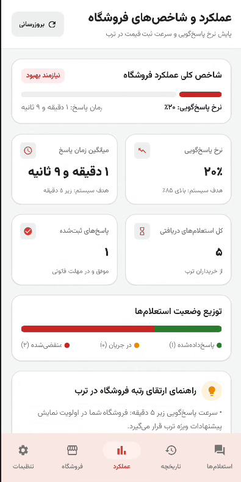
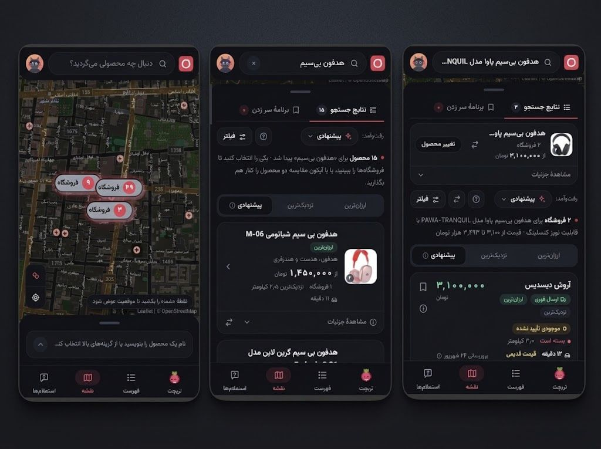
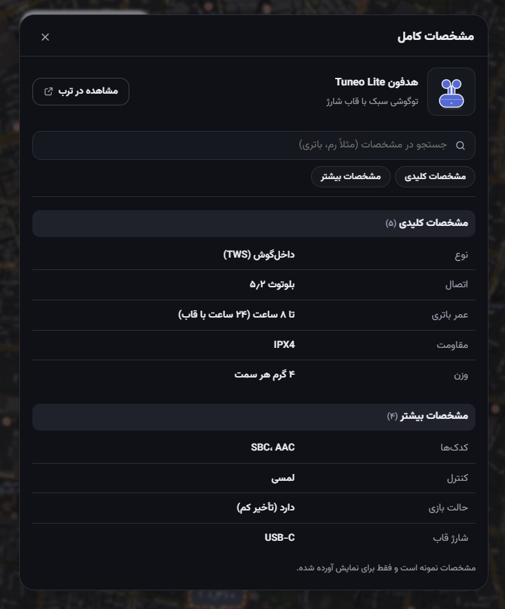

# 📸 TorobMap Screenshots & Visual Assets Catalog

  <b>🌐 Select Language / انتخاب زبان:</b>
  <a href="README.md"><b> 🇮🇷 فارسی (Default)</b></a> |
  <a href="README_EN.md"><b> 🇬🇧 English</b></a>

---

This directory contains high-resolution screenshots and visual assets capturing the key workflows of the **TorobMap** platform across the Shopper Web App (`trobapp`) and the Merchant Android App (`torob_merchant_app`).

---

## 📑 Screenshots Index & System Mapping

| File | Component | Platform / Dimensions | Screen / Capability | Role in Ecosystem |
|---|---|---|---|---|
| [`androidapp-1.png`](androidapp-1.png) | `torob_merchant_app` | Android (391×742) | Merchant Login & Authentication | Mobile / landline OTP login & one-tap dev bypass |
| [`androidapp-2.png`](androidapp-2.png) | `torob_merchant_app` | Android (395×789) | Inquiry Lifecycle & History | Track `TRB-...` codes, price comparisons & states |
| [`androidapp-3.png`](androidapp-3.png) | `torob_merchant_app` | Android (395×789) | Merchant SLA Scorecard & Analytics | Response rate (20% vs 85%), speed (1m 9s) & trust tips |
| [`androidapp-4.png`](androidapp-4.png) | `torob_merchant_app` | Android (397×790) | Urgent Inquiry Call Overlay ⭐ | Fullscreen 2-minute live countdown & ringing takeover |
| [`androidapp-5.png`](androidapp-5.png) | `torob_merchant_app` | Android (397×790) | Structured Decline Reason Modal | Categorized rejection reasons feeding Bayesian trust |
| [`androidapp-6.png`](androidapp-6.png) | `torob_merchant_app` | Android (393×111) | System Push Notification Banner | High-priority heads-up banner in Android notification bar |
| [`androidapp-7.jpg`](androidapp-7.jpg) | `torob_merchant_app` | Composite (1280×1280) | Merchant Platform Showcase Poster | Multi-screen overview poster of the merchant ecosystem |
| [`web-1.jpg`](web-1.jpg) | `trobapp` | Web (1280×800) | Home & TorobChat AI Assistant | Natural language RAG shopping consultation & store trip |
| [`web-2.jpg`](web-2.jpg) | `trobapp` | Web (1024×765) | Search, Map & Store Comparison | Physical store comparison, distance, ETA & routing |
| [`web-3.png`](web-3.png) | `trobapp` | Web Desktop (2538×1267) | Desktop 2-Panel Live Map & Directory ⭐ | Split view with Tehran Leaflet map & rich store cards |
| [`web-4.png`](web-4.png) | `trobapp` | Web Mobile (484×729) | Store Details & Transit Guidance | Physical address, hours, phone, TorobPay & car advice |
| [`web-5.png`](web-5.png) | `trobapp` | Web Mobile (490×1130) | Side-by-Side Product Comparison Drawer | Comparison matrix: price, store stock, distance & battery |
| [`web-6.png`](web-6.png) | `trobapp` | Web Modal (734×884) | Full Technical Specifications with Search | In-modal search, IPX4 rating, weight, codecs & latency |

---

## 📱 Merchant Android App Screenshots

### 1. Merchant Login & Authentication (`androidapp-1.png`)

- **Screen Role**: Onboarding screen for store managers into the Torob Merchant System.
- **Key Highlights**:
  - Dual login options: Mobile phone number or physical store landline (landlines receive automated voice OTP via Poshteyar TTS).
  - Direct dev login shortcut for quick evaluation and offline testing.

### 2. Inquiry Lifecycle & Audit Trail (`androidapp-2.png`)

- **Screen Role**: Full audit log of all customer inquiries across lifecycle states (Answered, Expired, Out of Stock, Declined).
- **Key Highlights**:
  - Unique inquiry tracking codes (`TRB-E77249`, `TRB-D53762`).
  - Displays product title, reference price, merchant's offered price, and shopper's custom notes.
  - Search bar by product title, tracking code, or shopper name.

### 3. Merchant SLA Scorecard & Analytics (`androidapp-3.png`)

- **Screen Role**: Performance metrics dashboard tracking merchant responsiveness and ranking.
- **Key Highlights**:
  - Overall performance evaluation ("Needs Improvement").
  - Response rate: 20% (system benchmark: 85%+).
  - Average response time: 1 minute 9 seconds (benchmark: under 5 minutes).
  - Breakdown chart of answered, unanswered, and expired requests.

### 4. Urgent Inquiry Call Overlay (`androidapp-4.png`) ⭐

- **Screen Role**: The signature "hero" interaction: a full-screen takeover simulating an incoming phone call.
- **Key Highlights**:
  - Continuous ringtone and vibration triggered even when the phone is locked.
  - 2-minute urgent SLA live countdown timer.
  - Product details (Samsung Galaxy S24 Ultra), customer name, custom message ("Do you have Titanium Gray in stock with official warranty?"), and last recorded price.
  - Three one-tap actions: "Declare Price & Stock", "Quickly Confirm Previous Price", and "Decline Inquiry".

### 5. Structured Decline Reason Modal (`androidapp-5.png`)

- **Screen Role**: Mandatory rejection classification dialog feeding the Bayesian trust engine.
- **Key Highlights**:
  - Categorized reasons: Store currently closed, product discontinued/not sold here, price cannot be verified, invalid request, other.
  - Transforms rejections into structured evidence instead of silent ignored requests.

### 6. Android System Heads-Up Notification (`androidapp-6.png`)

- **Screen Role**: High-priority Android notification bar banner alerting the merchant of incoming inquiries.

### 7. Merchant Platform Overview Poster (`androidapp-7.jpg`)

- **Screen Role**: Comprehensive visual summary showcasing call takeover, response slider, decline reasons, and system notifications.

---

## 🌐 Shopper Web App Screenshots

### 1. Home & TorobChat AI Shopping Assistant (`web-1.jpg`)

- **Screen Role**: Web desktop interface featuring TorobChat, an AI assistant powered by RAG on 225k products and 6.4k physical stores.
- **Key Highlights**: Quick prompt chips, city selector (Tehran), and the "Store Visits" route planner.

### 2. Search, Map & Store Comparison (`web-2.jpg`)

- **Screen Role**: Mobile/split view of in-person shopping search results with Leaflet map markers, distance calculations, and open/closed indicators.

### 3. Desktop 2-Panel Live Map & Directory (`web-3.png`) ⭐

- **Screen Role**: 2538×1267 wide desktop view seamlessly combining interactive map clusters on the right and detailed store listings on the left.
- **Key Highlights**: Sorting by cheapest, nearest, and algorithmic recommendation; real-time distance and ETA; available stock color tags.

### 4. Store Details & Transit Guidance (`web-4.png`)

- **Screen Role**: Slide-out store drawer providing physical address, business hours, verified landline and mobile numbers, payment methods (TorobPay, installment), and optimal transit mode advice.

### 5. Side-by-Side Product Comparison Drawer (`web-5.png`)

- **Screen Role**: Multi-product comparison matrix evaluating in-person availability, lowest physical store price, nearest store distance, battery life, and form factors.

### 6. Full Technical Specifications Sheet (`web-6.png`)

- **Screen Role**: Modal detailing hardware specs with live in-modal search for IPX4 water resistance, earbud weight, Bluetooth codec support, and gaming mode latency.

---

## 📸 Guide for Adding New Screenshots

1. Launch `trobapp` locally (`npm run dev`) and access `http://localhost:3000`.
2. Save your new PNG/JPG screenshots into this folder (`/root/torob-repo/screenshots/`).
3. Update the index table above and corresponding documentation files in `docs/`.
