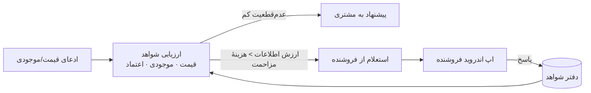
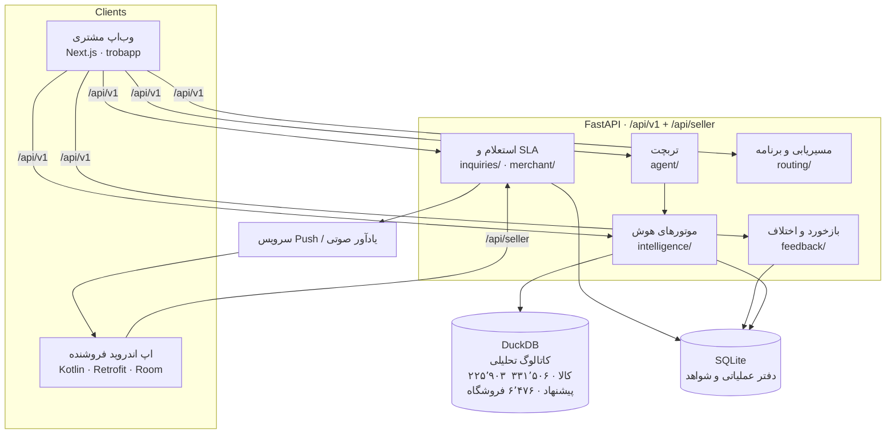
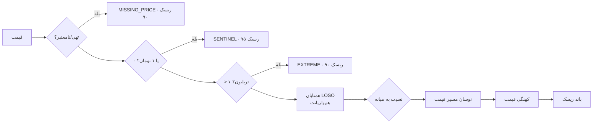
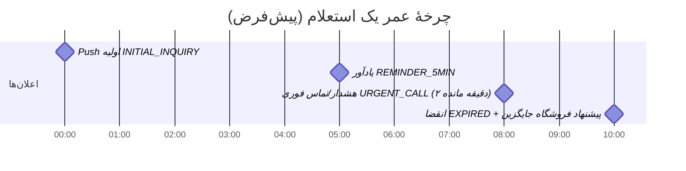
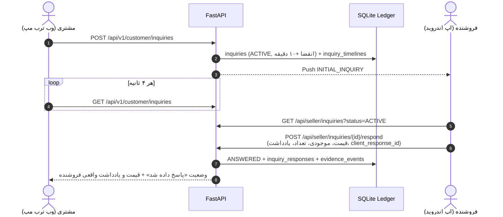
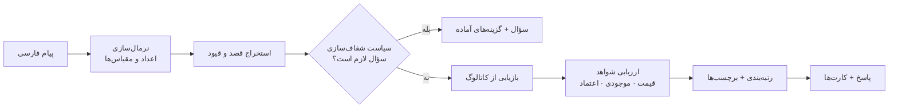

# ترب مپ · موتور هوشمند شواهد‌محور برای خرید حضوری
### Torob Evidence-Driven Intelligence Engine — Starcoach AI Hackathon

> **English summary.** Price-comparison sites answer *"who is cheapest?"*. A shopper who is about to **drive across Tehran** needs a different answer: *"if I leave now, will this shop still have it, at this price, when I arrive — and can I trust them?"*
> This backend answers that question with evidence instead of guesses. It scores every offer on **price plausibility** (leave-one-shop-out peer median, Rial/Toman unit-error detection), **stock survival until arrival** (ETA-aware exponential hazard model), and **multi-dimensional shop trust** (time-decayed Beta-Binomial with Bayesian shrinkage). When uncertainty is worth resolving, a **value-of-information policy** decides whether to ask the merchant — respecting quiet hours, daily caps and cooldowns — and routes a live inquiry to the merchant's **native Android app** with an SLA ladder (push → 5-min reminder → urgent call → expiry). Every merchant answer is written to an append-only **evidence ledger** that feeds back into trust scores. On top sits **TorobChat**, a Persian shopping assistant over a real 225,903-product / 331,506-offer / 6,476-shop catalogue.

---

## فهرست

1. [مسئله و ایدهٔ اصلی](#۱-مسئله-و-ایدهٔ-اصلی)
2. [معماری کل سامانه](#۲-معماری-کل-سامانه)
3. [الگوریتم موجود / ناموجود / نامشخص](#۳-الگوریتم-موجود--ناموجود--نامشخص)
4. [هوش قیمت](#۴-هوش-قیمت)
5. [اعتماد چندبعدی فروشگاه](#۵-اعتماد-چندبعدی-فروشگاه)
6. [روش استعلام](#۶-روش-استعلام-کی-بپرسیم-چطور-بپرسیم)
7. [تربچت: دستیار خرید](#۷-تربچت-دستیار-خرید)
8. [مسیریابی و برنامهٔ سر زدن](#۸-مسیریابی-و-برنامهٔ-سر-زدن)
9. [بازخورد و رسیدگی به اختلاف](#۹-بازخورد-و-رسیدگی-به-اختلاف)
10. [API](#۱۰-نمای-کلی-api)
11. [اجرا و استقرار](#۱۱-اجرا-و-استقرار)

📘 توضیح فنی عمیق‌تر، فرمول‌ها و تصمیم‌های طراحی: [`docs/SYSTEM_DESIGN.md`](docs/SYSTEM_DESIGN.md)

---

## ۱. مسئله و ایدهٔ اصلی

قیمتی که روی سایت دیده می‌شود **یک ادعا** است، نه یک واقعیت. ممکن است:
- به ریال وارد شده باشد نه تومان (۱۰ برابر)،
- ماه‌ها به‌روز نشده باشد،
- کالا در انبار دیگری باشد نه در مغازه،
- آخرین عدد آن تا رسیدن مشتری فروخته شود.

ایدهٔ ما ساده و قدرتمند است: **هر ادعا را با شواهد بسنج، عدم‌قطعیت را صادقانه نشان بده، و فقط وقتی از فروشنده بپرس که ارزش پرسیدن از هزینهٔ مزاحمت بیشتر است.** پاسخ فروشنده دوباره به شواهد تبدیل می‌شود و سیستم با هر استعلام دقیق‌تر می‌شود.



---

## ۲. معماری کل سامانه



| لایه | فناوری | نقش |
|---|---|---|
| وب مشتری | Next.js 14 (`trobapp`) | رابط RTL فارسی، نقشه Leaflet، تربچت، استعلام‌ها |
| اپ فروشنده | Kotlin/Compose (`torob_merchant_app`) | صندوق استعلام، پاسخ آفلاین‌پذیر، باز/بسته کردن فروشگاه |
| API | FastAPI + Pydantic v2 | قراردادهای تایپ‌شده، RBAC سبک مبتنی بر هدر |
| کاتالوگ | DuckDB | بارگذاری ۵۶۰ هزار ردیف CSV در حدود ۱ ثانیه، جستجوی فارسی و کوئری همتایان |
| دفتر عملیاتی | SQLite | استعلام‌ها، پاسخ‌ها، فروشندگان، تایم‌لاین SLA، **دفتر شواهد افزایشی** |
| سیاست‌ها | `configs/policy.yaml` | همهٔ آستانه‌ها قابل تنظیم بدون تغییر کد |

---

## ۳. الگوریتم موجود / ناموجود / نامشخص

کد: [`src/torob/intelligence/inventory.py`](src/torob/intelligence/inventory.py)

### ۳.۱ وضعیت‌ها — «موجود» یک بیت نیست

```
in_store_sellable · in_other_warehouse · supplier_available · preorder
reserved · display_only · defective · out_of_stock · unknown
```

فقط `in_store_sellable` برای خرید حضوری «موجود» است. «در انبار دیگر» یا «پیش‌خرید» برای کسی که در راه است عملاً ناموجود است.

**قاعدهٔ طلایی (در policy):** `never_use_no_response_as_out_of_stock: true` — جواب‌ندادن فروشنده هرگز به‌معنی «ناموجود» نیست؛ «نامشخص» است. این از جریمهٔ ناعادلانهٔ فروشندهٔ شلوغ جلوگیری می‌کند.

### ۳.۲ احتمال بقای موجودی تا رسیدن مشتری

موجودی تأییدشده با گذر زمان «فرسوده» می‌شود. زمان مؤثر = زمانِ گذشته از آخرین تأیید + زمان سفر مشتری:

$$t = \Delta t_{\text{since verify}} + \text{ETA}_{\text{travel}}$$

$$S(t) = e^{-\lambda t}, \qquad \lambda = \lambda_0 \cdot m_{\text{qty}}, \quad \lambda_0 = 0.05\ \text{h}^{-1}$$

| دستهٔ تعداد (quantity bucket) | ضریب خطر $m_{\text{qty}}$ | تفسیر |
|---|---|---|
| `1_unit` | 2.5 | تک‌عدد؛ ممکن است قبل از رسیدن فروخته شود |
| `2_to_5` | 1.0 | موجودی کم |
| `gt_5` | 0.3 | موجودی زیاد؛ برای یک سفر کوتاه تقریباً امن |
| `unknown` | 1.2 | محافظه‌کارانه |

خروجی به بازهٔ $[0.05, 0.99]$ محدود می‌شود (هیچ‌وقت ادعای قطعیت ۱۰۰٪ نمی‌کنیم) و همیشه با `is_calibrated=false` برچسب می‌خورد. برای `out_of_stock`، $S=0$.

**مثال:** فروشنده ۲ ساعت پیش گفته «۱ عدد دارم» و مشتری ۴۰ دقیقه راه دارد:
$\lambda = 0.05 \times 2.5 = 0.125$ ، $t = 2.67$ ساعت ← $S \approx e^{-0.33} \approx 0.72$.

### ۳.۳ کیفیت شاهد

| زمان از آخرین تأیید | کیفیت شاهد |
|---|---|
| < ۴ ساعت | `HIGH` |
| < ۲۴ ساعت | `MODERATE` |
| بیشتر / بدون تأیید | `LIMITED` |

### ۳.۴ پاسخ فروشنده چطور وضعیت را عوض می‌کند

پاسخ فروشنده (قیمت، `is_in_stock`، `stock_count` دقیق، یادداشت) وضعیت استعلام را به `ANSWERED` یا `OUT_OF_STOCK` یا `DECLINED` می‌برد، زمان تأیید موجودی را صفر می‌کند (یعنی $S$ دوباره بالا می‌رود) و یک **رویداد شاهد** در دفتر ثبت می‌کند. `stock_count = 0` دقیقاً حفظ می‌شود و هرگز با ۱ جایگزین نمی‌شود.

---

## ۴. هوش قیمت

کد: [`src/torob/intelligence/pricing.py`](src/torob/intelligence/pricing.py)

یک خط لولهٔ چندمرحله‌ای که به هر قیمت **امتیاز ریسک ۰ تا ۱۰۰** و دلیل‌های فارسی خوانا می‌دهد:



1. **دروازه‌های کیفیت:** قیمت تهی، مقادیر ساختگی (۰ و ۱ تومان)، بالای ۱ تریلیون یا زیر ۱٬۰۰۰ تومان.
2. **قیمت مرجع Leave-One-Shop-Out:** میانهٔ قیمت **سایر فروشگاه‌ها** برای *همان واریانت* (فروشگاه ارزیابی‌شده کنار گذاشته می‌شود تا خودش مرجع خودش نباشد؛ واریانت‌های ناسازگار مثل حافظه یا وضعیت متفاوت حذف می‌شوند). حداقل ۲ فروشگاه مستقل لازم است.

$$r = \frac{p}{\operatorname{median}\{p_j : j \neq \text{shop},\ \text{variant-compatible}\}}$$

| نسبت $r$ | تشخیص | ریسک |
|---|---|---|
| $9 \le r \le 11$ | احتمال درج **ریال به‌جای تومان** | +۶۵ |
| $0.09 \le r \le 0.11$ | خطای معکوس تبدیل واحد | +۶۵ |
| $r \ge 3$ | بسیار گران‌تر از بازار | +۵۰ |
| $r \le 1/3$ | به‌طرز مشکوکی ارزان | +۴۰ |
| همتای کافی نیست | تک‌فروشنده | +۱۵ |

3. **نوسان مسیر:** اگر قیمت مسیر پرنوسانی داشته ولی تغییر خالص کم بوده (+۲۵)، شوک بازار (+۳۰)، نوسان بالا (+۱۵).
4. **کهنگی:** ≥۳۰ روز (+۲۰)، ≥۹۰ روز (+۳۵، وضعیت `STALE`).
5. **باند:** `≥75 CRITICAL` · `≥50 HIGH` · `≥25 MEDIUM` · در غیر این صورت `LOW`. کیفیت شاهد با تعداد همتا بالا می‌رود (۳+ متوسط، ۵+ بالا).

---

## ۵. اعتماد چندبعدی فروشگاه

کد: [`src/torob/intelligence/shop_reliability.py`](src/torob/intelligence/shop_reliability.py)

«امتیاز فروشگاه» یک عدد مبهم نیست؛ شش بعد مستقل دارد که هر کدام یک توزیع **Beta** است:

| بعد | prior $(\alpha_0,\beta_0)$ | میانگین prior |
|---|---|---|
| صحت قیمت `price_fidelity` | (4.0, 1.0) | 0.80 |
| صحت موجودی `stock_accuracy` | (3.5, 1.5) | 0.70 |
| پاسخ‌گویی به استعلام `inquiry_responsiveness` | (3.0, 2.0) | 0.60 |
| حضور فیزیکی `physical_presence` | (4.5, 0.5) | 0.90 |
| صحت نشانی `address_accuracy` | (4.5, 0.5) | 0.90 |
| اعتبار تجاری `commercial_trust` | (3.5, 1.5) | 0.70 |

**به‌روزرسانی مزدوج Beta-Binomial با فرسایش زمانی** (نیمه‌عمر ۶۰ روز):

$$w_i = e^{-\lambda_d \cdot \text{age}_i}, \quad \lambda_d = \frac{\ln 2}{60}$$

$$\alpha = \alpha_0 + \sum_i w_i\, s_i, \qquad \beta = \beta_0 + \sum_i w_i (1 - s_i), \qquad \hat\theta = \frac{\alpha}{\alpha+\beta}$$

- **Shrinkage بیزی:** وزن prior برابر ۵ مشاهده است؛ فروشگاه تازه‌کار با یک گزارش بد نابود نمی‌شود و فروشگاه با یک گزارش خوب «عالی» نمی‌شود.
- **بدون جریمهٔ ابدی:** شواهد قدیمی به‌صورت نمایی کم‌اثر می‌شوند.
- **بازهٔ اطمینان ۹۵٪** از چندک‌های دقیق Beta و **اندازهٔ نمونهٔ مؤثر Kish** $n_{\text{eff}} = (\sum w)^2 / \sum w^2$ گزارش می‌شود.

$$\text{Composite} = 0.25\,\hat\theta_{\text{price}} + 0.25\,\hat\theta_{\text{stock}} + 0.20\,\hat\theta_{\text{presence}} + 0.15\,\hat\theta_{\text{commercial}} + 0.15\,\hat\theta_{\text{responsive}}$$

---

## ۶. روش استعلام: کی بپرسیم، چطور بپرسیم

### ۶.۱ تصمیم‌گیری مبتنی بر ارزش اطلاعات (VoI)

کد: [`src/torob/intelligence/inquiry_policy.py`](src/torob/intelligence/inquiry_policy.py) — سیاست `voi_adaptive_v2`

هر استعلام وقت فروشنده را می‌گیرد. پس **فقط وقتی می‌پرسیم که سود مورد انتظارِ دانستن، از هزینهٔ مزاحمت بیشتر باشد.** همهٔ مقادیر به واحد «امتیاز زیان استاندارد» (SLP، هر SLP = ۱۰٬۰۰۰ تومان) بیان می‌شوند تا جمع‌شدنی باشند.

**دروازه‌های سخت (قبل از هر محاسبه):**
- ساعات سکوت ۲۲:۰۰ تا ۰۹:۰۰ ← تعویق
- سقف روزانهٔ هر فروشگاه (۱۵ استعلام) ← رد یا تعویق
- فاصلهٔ خنک‌سازی ۱۲۰ ثانیه بین استعلام‌ها

**زیان بالقوهٔ تصمیم:**

$$P_{\text{eff}} = P_0 \ln\!\left(1 + \tfrac{p}{P_0}\right),\ P_0 = 25\text{M} \quad\Rightarrow\quad L_{\text{price}} = \frac{P_{\text{eff}} \cdot \tfrac{\text{risk}}{100} \cdot 0.10}{10^4}$$

$$L_{\text{stock}} = \big(15 + 0.2\cdot \text{travel\_min} + \min(50,\ 0.02p/10^4)\big)\cdot 0.40 \quad (\text{اگر موجودی نامشخص})$$

$$L_{\text{regime}} = \max(25,\ 0.03p/10^4) \quad (\text{اگر بازار در شوک یا کشف قیمت})$$

**ارزش اطلاعات:**

$$\text{VoI} = (L_{\text{price}} + L_{\text{stock}} + L_{\text{regime}})\cdot w_{\text{intent}} \cdot P(\text{پاسخ مفید}) \;-\; (10 + 1.5\,n_{\text{today}}) \;-\; 1$$

- $w_{\text{intent}}$: «سر زدن حضوری» ۱.۶، «خرید» ۱.۲، «مرور» ۰.۳ — مشتری‌ای که واقعاً راه می‌افتد بیشتر ارزش پرسیدن دارد.
- $P(\text{پاسخ مفید})$ همان بعد **پاسخ‌گویی** در مدل اعتماد فروشگاه است (حلقهٔ بازخورد!).
- هزینهٔ مزاحمت با هر استعلامِ امروز ۱.۵ واحد بالا می‌رود (خستگی فروشنده).
- خروجی: `VoI > 0` ← استعلام؛ `VoI > 80` ← اولویت `URGENT`، `> 50` یا قصد خرید/سر زدن ← `HIGH`.

### ۶.۲ ضد تکرار و ادغام

کلید یکتای `shop_id:product_id:offer_id` باعث می‌شود چند مشتری که هم‌زمان یک کالا را از یک فروشگاه می‌پرسند، **یک استعلام** تولید کنند (Coalescing) و فروشنده یک بار جواب دهد.

### ۶.۳ نردبان SLA و اپ اندروید فروشنده

کد: [`src/torob/merchant/scheduler.py`](src/torob/merchant/scheduler.py) — زمان‌ها در جدول `scheduler_configs` قابل تنظیم‌اند.



### ۶.۴ پاسخ ایدمپوتنت و آفلاین

- هر پاسخ یک `client_response_id` دارد؛ ارسال دوباره (شبکهٔ ضعیف، صف آفلاین Room در اندروید، `batch-sync`) **هرگز** رکورد تکراری نمی‌سازد.
- پاسخ ← `UPDATE inquiries` + `INSERT inquiry_responses` + `INSERT evidence_events`.
- انقضا هم شاهد است: `merchant_unresponsive` در دفتر ثبت می‌شود و روی بعد «پاسخ‌گویی» اثر می‌گذارد — اما **نه** روی «صحت موجودی».

### ۶.۵ سفر کامل یک استعلام



این مسیر در دموی ما به‌صورت سرتاسری تست شده است: استعلام از وب در صندوق اپ فروشنده ظاهر می‌شود و پاسخ فروشنده در کمتر از ۵ ثانیه در صفحهٔ «استعلام‌ها»ی وب با کد پیگیری نمایش داده می‌شود.

---

## ۷. تربچت: دستیار خرید

کد: [`src/torob/agent/`](src/torob/agent/)



- **قصدها:** جستجوی دقیق، نیازسنجی، جستجوی بودجه‌ای، خرید حضوری محلی، مقایسهٔ کالا، سبد چندکالایی، خرید سر راه، خوشهٔ فروشگاه‌های نزدیک، انتخاب شخصی‌سازی‌شده، بازبرنامه‌ریزی تطبیقی.
- **نرمال‌سازی فارسی:** ارقام فارسی/عربی، «۷۰ میلیون»، «۸۵ همت»، و ابهام مقیاس مثل «۳۰ تومن» (برای لوازم جانبی یعنی ۳۰ هزار، برای گوشی یعنی ۳۰ میلیون) که در صورت ابهام از کاربر پرسیده می‌شود.
- **سیاست شفاف‌سازی با بودجهٔ سؤال:** جستجوی دقیق ۰ سؤال، خرید حضوری ۱، نیازسنجی ۲، سبد ۳ — هیچ‌وقت بیشتر. گزینه‌های پاسخ به‌صورت دکمه برمی‌گردند.
- **رتبه‌بندی قطعی و شواهد‌محور:** امتیاز تناسب در $[0.05, 0.98]$ از نسبت قیمت به بودجه، انطباق با میانهٔ بازار، اعتماد فروشگاه و ترجیحات مشخصات. برچسب‌ها: `best_overall` · `budget_pick` · `verified_confidence`.
- **بدون توهم:** هر کالا و قیمتی که نمایش داده می‌شود مستقیماً از کاتالوگ و ارزیاب‌ها آمده است؛ متن فروشندگان پیش از ورود به هر مدل زبانی پاک‌سازی می‌شود (ضد Prompt Injection).
- **جلسات پایدار:** سشن‌ها در SQLite با TTL و ایزوله‌سازی کاربر (403 برای دسترسی متقاطع).
- **LLM اختیاری:** هستهٔ تجزیه کاملاً آفلاین و قطعی است. لایهٔ `OpenAICompatibleProvider` و رجیستری ۱۷ ابزار (جستجوی کالا، ارزیابی پیشنهاد، اعتماد فروشگاه، ساعات کاری، مسیر، سبد، …) برای اتصال به هر API سازگار با OpenAI آماده است: `TOROB_LLM_PROVIDER` · `TOROB_LLM_API_KEY` · `TOROB_LLM_BASE_URL` · `TOROB_LLM_MODEL`. LLM فقط جای خالی تجزیهٔ قطعی را پر می‌کند و پاسخ نهایی را بازنویسی می‌کند؛ هر بازنویسی که عددی خارج از دادهٔ واقعی داشته باشد رد می‌شود (بدون توهم قیمت/موجودی). راهنمای اتصال به OpenAI، BoxAPI و … : [docs/LLM_PROVIDERS.md](docs/LLM_PROVIDERS.md).

---

## ۸. مسیریابی و برنامهٔ سر زدن

کد: [`src/torob/routing/`](src/torob/routing/) · [`src/torob/intelligence/basket_optimizer.py`](src/torob/intelligence/basket_optimizer.py)

- فاصلهٔ جاده‌ای ≈ $1.3 \times$ فاصلهٔ هاورساین؛ پیاده ۵ km/h، خودرو ۲۵ km/h (میانگین شهری تهران)، ۱۰ دقیقه توقف در هر فروشگاه.
- پارس ساعات کاری هفتگی و هشدار «تا رسیدن شما بسته می‌شود» (۶۰ دقیقه پیش از بسته‌شدن).
- **خرید سر راه:** فاصلهٔ نقطه تا پاره‌خط مسیر و محاسبهٔ انحراف واقعی.
- **بهینه‌سازی سبد چندفروشگاهی:** ترکیب‌های فروشگاه با راهبردهای «ارزان‌ترین»، «کم‌توقف‌ترین»، «سریع‌ترین»، «مطمئن‌ترین» و «متوازن».
- **بازبرنامه‌ریزی:** وقتی فروشنده می‌گوید «ناموجود»، برنامه خودکار با فروشگاه جایگزین ترمیم می‌شود.

---

## ۹. بازخورد و رسیدگی به اختلاف

کد: [`src/torob/feedback/service.py`](src/torob/feedback/service.py)

- گزارش مثبت و منفی هر دو پذیرفته می‌شوند (خرید موفق هم شاهد است).
- **هیچ جریمهٔ مستقیمی از یک گزارش منفی نیست**؛ پرونده باز می‌شود، فروشنده حق دفاع (Appeal) دارد، و فقط پس از رسیدگی اثرش به دفتر شواهد و مدل اعتماد می‌رسد.
- هویت گزارش‌دهنده به فروشنده افشا نمی‌شود؛ پرچم خودکار فقط با حداقل ۳ گزارش.

---

## ۱۰. نمای کلی API

مستندات تعاملی: `GET /docs` · قرارداد کامل: [`docs/FRONTEND_INTEGRATION_GUIDE.md`](docs/FRONTEND_INTEGRATION_GUIDE.md)

| حوزه | مسیر | توضیح |
|---|---|---|
| سلامت | `GET /api/v1/health` | وضعیت و شمار کاتالوگ |
| کاتالوگ | `GET /api/v1/products?q=` · `/products/{id}/offers` · `/shops/{id}` | جستجوی فارسی و پیشنهادها |
| ارزیابی | `GET /api/v1/offers/{id}/assessment` | قیمت + موجودی + اعتماد در یک پاسخ |
| تربچت | `POST /api/v1/assistant/sessions` · `POST /sessions/{id}/messages` | دستیار خرید |
| استعلام مشتری | `POST/GET /api/v1/customer/inquiries` | ایجاد و پیگیری زنده |
| برنامه‌ها | `POST /api/v1/shopping-plans/on-route` · `/basket` · `/nearby-clusters` · `/compare-products` | برنامهٔ خرید |
| برنامهٔ ذخیره‌شده | `/api/v1/customer/saved-plans` | ذخیره و تیک‌زدن توقف‌ها |
| نقشه | `GET /api/v1/map/stores` | فروشگاه‌ها در محدودهٔ نقشه |
| فروشنده (اندروید) | `/api/seller/auth/request-otp` · `verify-otp` · `/seller/inquiries` · `/inquiries/{id}/respond` · `/inquiries/batch-sync` · `/shop` · `/metrics` | قرارداد Retrofit اپ فروشنده |

---

## ۱۱. اجرا و استقرار

### اجرای محلی

```bash
python3 -m venv .venv && .venv/bin/pip install -e .
./scripts/run_server.sh          # پورت پیش‌فرض 8080 · مستندات: http://localhost:8080/docs
.venv/bin/pytest                 # ۱۵۰+ آزمون
```

وب‌اپ مشتری: [`../trobapp`](../trobapp) — `npm install && npm run build && npm start` با `BACKEND_API_URL=http://127.0.0.1:8080`.

### استقرار روی لیارا

بک‌اند و فرانت‌اند به‌صورت **دو اپلیکیشن جداگانه** روی لیارا پیکربندی شده‌اند (`liara.json` در هر مخزن). بک‌اند یک ایمیج Docker است (`Dockerfile`) که کاتالوگ را از CSVهای فشرده (`data/*.csv.gz`) در DuckDB بارگذاری می‌کند و دفتر SQLite را روی دیسک پایدار `/data` نگه می‌دارد.

```bash
# یک‌بار: شبکه، اپ‌ها و دیسک
liara network create -n torobnet
liara app create -a torobmap-api --platform docker --plan standard-plus-g2 --feature-plan basic -n torobnet
liara app create -a torobmap     --platform next   --plan medium-g2        --feature-plan basic -n torobnet
liara disk create -a torobmap-api --name ledger --size 2
# استقرار
cd torob   && (cd data && gzip -kf shops.csv products.csv offers.csv) && liara deploy
cd trobapp && liara deploy
```

| سرویس | آدرس |
|---|---|
| بک‌اند (FastAPI) | `https://torobmap-api.liara.run` — مستندات: `https://torobmap-api.liara.run/docs` |
| وب مشتری (Next.js) | `https://torobmap.liara.run` |

فرانت‌اند با متغیر `BACKEND_API_URL=https://torobmap-api.liara.run` درخواست‌های `/api/v1` را به بک‌اند پراکسی می‌کند.

### اتصال اپ اندروید فروشنده

آدرس سرور را در تنظیمات اپ روی `https://torobmap-api.liara.run/api/` بگذارید (یا مقدار `BASE_URL` در `android/app/build.gradle.kts`). در توسعهٔ محلی: `adb reverse tcp:8080 tcp:8080`.

### حساب‌های آزمایشی

| نقش | ورود | فروشگاه |
|---|---|---|
| فروشندهٔ دمو | `09123456789` · کد `123456` | موبایل تخت جمشید |
| فروشگاه آزمایشی (گیرندهٔ استعلام‌های وب) | `09120000000` · کد `123456` | `فروشگاه جیمبو` — ۱۷ کالای واقعی کاتالوگ با قیمت آزمایشی |

در حالت دمو، کد یکبار مصرف در پاسخ `request-otp` هم برمی‌گردد.

---

### صداقت داده

- همهٔ احتمال‌ها برچسب `is_calibrated=false` دارند و «مدل اکتشافی» نامیده می‌شوند؛ پارامترها در `policy.yaml` قابل کالیبراسیون با دادهٔ واقعی‌اند.
- سیستم هیچ پاسخ فروشنده‌ای را جعل نمی‌کند؛ اگر بک‌اند در دسترس نباشد، وب‌اپ پاسخ شبیه‌سازی‌شده را صریحاً با برچسب «نمونه» نشان می‌دهد.
