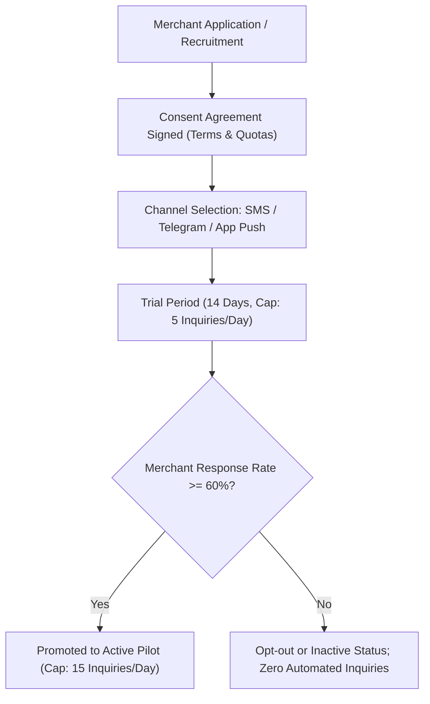
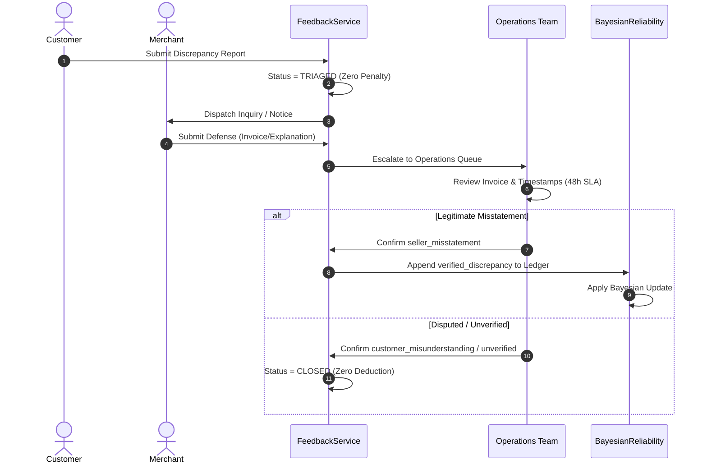

# Torob Intelligence Engine — Pilot Readiness & Production Deployment Assessment

**Document Version:** `2.1.0`  
**Target Environment:** Controlled Tehran Pilot (Phase 1)  
**Status:** Pilot-Ready (Backend Verified; Operational External Infrastructure Pending)  
**Classification:** Internal Engineering & Operations  

---

## 1. Executive Summary & Pilot Boundary

The **Torob Intelligence Engine** has completed all core backend algorithmic modules, including:
- Price anomaly detection & Leave-One-Shop-Out (LOSO) market median comparisons.
- Active verification under a dimensionally sound **Heuristic Verification Priority Utility (HVPU)**.
- Multi-dimensional Bayesian shop reliability with Kish effective sample size bounding.
- Contextual on-route journey shopping with explicit baseline vs dwell-time separation.
- Combinatorial multi-store basket optimization with honest partial coverage accounting.
- Adaptive shopping plan recovery upon merchant stockout or price rejection.
- Conversational assistant session management via REST APIs.

Before initiating live merchant or customer outreach, this document defines the operational boundaries, safety controls, risk mitigations, and required production infrastructure.

> [!IMPORTANT]
> **No external merchant communication or production deployment should be initiated without formal executive authorization.** The pilot must remain bounded within a designated geographic district (e.g., Tehran District 6 / Enqelab-Valiasr corridor) with participating merchants who have granted written opt-in consent.

---

## 2. Implemented Capabilities vs Missing Infrastructure

To ensure absolute calibration honesty, we explicitly distinguish between capabilities already fully implemented and verified in the backend versus infrastructure components that require production integration:

| Component | Implemented in Backend | Required External Infrastructure | Readiness Status |
| :--- | :--- | :--- | :--- |
| **Inquiry Decision Engine** | Value-of-Information (HVPU) utility curve, fatigue bounds, quiet hours | Merchant SMS / WhatsApp / Push notification gateway | **Engine Ready; Gateway Required** |
| **Merchant Fatigue Protection** | Daily quota (15/day), 120s cooldown, quiet hours (22:00–09:00) | Redis distributed rate-limiter for multi-instance deployments | **Engine Ready; Cache Optional** |
| **Bayesian Shop Reliability** | Exact Beta quantiles (`scipy.stats.beta.ppf`), Kish $N_{\text{eff}}$ decay bound | Real customer visit outcomes from mobile app GPS logs | **Engine Ready; Data Feed Required** |
| **Merchant Fairness Pipeline** | Case triage, zero unverified deduction, auditable journal | Human operator portal for receipt & invoice document review | **Engine Ready; Ops UI Required** |
| **Catalogue Search & Storage** | DuckDB in-memory analytical catalogue (225k+ products) | Periodic parquet snapshot sync from Torob production cluster | **Engine Ready; Cron Sync Required** |
| **On-Route Optimization** | Haversine + Manhattan synthetic graph, detour calculation | OpenStreetMap / OSRM live traffic routing engine | **Engine Ready; OSRM Feed Required** |
| **Conversational Assistant** | Multi-turn session persistence, constraint extraction | Frontend UI chat widget (mobile web / app) | **Engine Ready; Backend-Only** |

---

## 3. Merchant Consent & Onboarding Workflow

Merchant trust is paramount. Torob must never spam or penalize unwilling merchants.



### Protocol Guidelines:
1. **Explicit Opt-In:** Only merchants who explicitly agree to the *Torob Real-Time Availability Pilot* will receive automated stock/price verification inquiries.
2. **Channel Preferences:** Merchants specify preferred contact channels (e.g., Telegram bot, SMS link, or merchant web portal).
3. **One-Click Opt-Out:** Every notification message contains a direct, zero-friction opt-out link. Clicking immediately pauses all inquiries to that shop.

---

## 4. Customer Feedback Collection & Discrepancy Triage

Customer feedback is a valuable signal but **cannot be treated as incontrovertible truth**.

### Verification Workflow:
1. **Reporting:** Customer flags an issue (e.g., `PRICE_MISMATCH`, `STOCK_UNAVAILABLE`) via the app.
2. **Automatic Triage:** The case is recorded in the SQLite ledger as `case_status=TRIAGED`, `outcome=NOT_YET_DETERMINED`.
3. **Zero Immediate Penalty:** The merchant's Bayesian composite score and search rankings remain completely unaffected.
4. **Merchant Notification & Response Window:** The merchant is notified and granted 48 business hours to respond with explanatory context or an invoice receipt.
5. **Resolution Attribution:**
   - `seller_misstatement`: Verified price hike or false stock claim $\implies$ Bayesian penalty applied to relevant dimension.
   - `customer_misunderstanding`: Customer confused variants, added optional accessories, or visited outside hours $\implies$ Zero penalty.
   - `catalogue_sync_delay`: Technical delay in Torob feed crawler $\implies$ Zero merchant penalty.
   - `unverified`: No documentary proof available $\implies$ Case closed as unverified; zero penalty.

---

## 5. Safe Inquiry Quotas & Seller Fatigue Limits

The backend enforces strict mathematical bounds to prevent notification fatigue:

| Constraint | Limit | Implementation Location | Failure Action |
| :--- | :--- | :--- | :--- |
| **Daily Inquiry Cap** | 15 inquiries / merchant / day | `inquiry_policy.py:max_daily` | Returns `decline_or_defer` (`daily_budget_exhausted`) |
| **Cooldown Period** | 120 seconds between inquiries | `inquiry_policy.py:cooldown_sec` | Defers inquiry to queue |
| **Quiet Hours** | 22:00 to 09:00 local time (Tehran) | `inquiry_policy.py:quiet_hours` | Suppresses external push; queues for 09:01 |
| **Fatigue Cost Scaling** | 10 SLP base $\to$ 50 SLP at cap | `inquiry_policy.py:loss_fatigue` | Increases hurdle rate for low-value inquiries |

---

## 6. Operational Monitoring & Real-Time Telemetry

The pilot system must expose Prometheus-compatible metrics and health checks:

### Core Metrics:
1. `torob_inquiries_dispatched_total{channel, shop_id}`: Monitored against daily caps.
2. `torob_inquiry_response_latency_seconds`: P50, P90, P99 merchant response duration.
3. `torob_bayesian_reliability_mean{dimension}`: Aggregate distribution across participating pilot merchants.
4. `torob_dispute_case_duration_hours`: SLA monitoring for operator review (target $< 48$h).
5. `torob_plan_invalidation_rate`: Fraction of multi-store plans requiring adaptive recovery.

### Health Telemetry:
- **Liveness Probe:** `/healthz` returning DuckDB connection state and memory usage.
- **Readiness Probe:** `/readyz` confirming catalogue snapshot freshness $< 24$ hours old.

---

## 7. Dispute Review & Escalation SLA

A merchant who disagrees with a recorded discrepancy has a right to administrative review:



---

## 8. Privacy, Authorization & Transaction Safety

1. **Role-Based Access Control (RBAC):**
   - `customer`: Can only view public assessments, create sessions, and submit feedback for their own visits.
   - `merchant`: Can view only their own inquiries, reliability assessments, and dispute cases.
   - `admin`: Can adjust priors, resolve disputes, trigger catalogue re-ingestion, and simulate policies.
2. **PII Masking:**
   - Customer phone numbers and device IDs are salted and hashed before persistence in the ledger (`actor_id = hash(phone + salt)`).
   - Merchant personal numbers are never exposed in client API responses.

---

## 9. Failure Recovery & Adaptive Replanning

In the event of an in-flight plan breakdown (e.g., store stockout):
1. **Preservation Principle:** Unaffected items remain locked in the shopping plan.
2. **Local Replacement Search:** The recovery engine prioritizes shops in the same geographic cluster or along the user's remaining route.
3. **Transparent Notification:** The customer receives a clear Persian explanation of what changed, why it changed, and how much time/cost is affected.

---

## 10. Minimum Real-World Success Metrics

For the pilot to graduate to broad production rollout, the following KPIs must be met over a 30-day evaluation window:

| Metric | Target KPI | Minimum Acceptable |
| :--- | :--- | :--- |
| **Merchant Opt-Out Rate** | $< 5\%$ | $< 10\%$ |
| **Merchant Inquiry Response Rate** | $> 70\%$ within 15 min | $> 50\%$ within 30 min |
| **Stock Discrepancy Reduction** | $> 40\%$ vs unverified catalogue | $> 25\%$ |
| **Customer Journey Completion Rate** | $> 85\%$ of generated plans | $> 75\%$ |
| **False-Positive Dispute Rate** | $< 8\%$ of total complaints | $< 15\%$ |

---

## 11. Rollback & Policy Versioning Matrix

If an algorithmic defect or unexpected market volatility occurs, the system supports instant policy rollback:

```python
# Policy version rollback mapping (config/production_policy.json)
{
  "active_policy_version": "voi-adaptive-v2.1-hvpu",
  "rollback_policy_version": "voi-conservative-v1.0",
  "emergency_killswitch": {
    "disable_all_inquiries": false,
    "force_high_uncertainty_warnings": false,
    "fallback_to_catalogue_listing_prices": false
  }
}
```

1. **Immediate Inquiry Cessation:** Setting `emergency_killswitch.disable_all_inquiries = true` stops all outgoing communications within 5 seconds without restarting backend services.
2. **Decoupled Engine Upgrades:** Changes to the VoI utility model, Bayesian priors, or routing metrics are tagged with unique semantic versions (`v2.1-hvpu`, `v2.0-kish-bound`) stored alongside every decision in the SQLite audit ledger.
