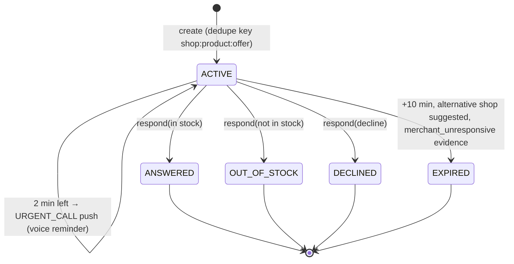

# System Design — Torob Evidence-Driven Intelligence Engine

This is the engineering companion to the [README](../README.md). It covers the design principles, the data model, how each algorithm fits the others, and what we deliberately left out. Every formula below matches the code it cites.

---

## 1. Design principles

| # | Principle | How it shows up in the code |
|---|---|---|
| P1 | **A listed price or stock flag is a claim, not a fact.** | Every offer is scored by `PriceIntelligenceEngine`, `InventoryIntelligenceEngine` and `ShopReliabilityEngine` before it is shown. |
| P2 | **Be honest about uncertainty.** | `evidence_quality` on every assessment, `is_calibrated=false` on every probability, survival clamped to `[0.05, 0.99]`, `probability_claim_allowed: false` in policy. |
| P3 | **Silence is not evidence of absence.** | `never_use_no_response_as_out_of_stock: true`. A timeout counts against *responsiveness*, never against *stock accuracy*. |
| P4 | **The merchant's attention is a scarce resource.** | VoI gate, daily cap, cooldown, quiet hours, coalescing. |
| P5 | **Every observation is an append-only event.** | `evidence_events` ledger. Trust scores are projections that can be recomputed. |
| P6 | **No eternal punishment.** | 60-day half-life decay and Bayesian priors. Disputes require a case and an appeal before any penalty. |
| P7 | **Config over code.** | `configs/policy.yaml` and the `scheduler_configs` table hold every threshold. |
| P8 | **The LLM is optional.** | A deterministic Persian parser and ranker give the same contract offline. An LLM only adds language skill on top. |

---

## 2. Component map

```
src/torob/
├── api/v1/            FastAPI routers (catalog, assessment, assistant, customer, plans, inquiries, feedback, seller, admin)
├── intelligence/      pricing · inventory · shop_reliability · inquiry_policy · volatility · market_dynamics
│                      basket_optimizer · plan_lifecycle · plan_recovery · personalized_recommender · calibration
├── agent/             orchestrator · llm (parser + providers + tool loop) · tools (17) · recommender · clarification · location
├── inquiries/         inquiry lifecycle service (dedupe, seller response, expiry)
├── merchant/          seller auth (OTP), push service, SLA scheduler, metrics, working hours
├── routing/           haversine + road multiplier, on-route detour, itinerary, hours, clustering
├── feedback/          customer reports, seller appeals, case resolution → ledger → reliability
├── storage/           DuckDB catalogue repo, SQLite ledger repo, merchant seed/import
└── ingestion/         CSV loader, Persian normaliser, snapshotting
```

### Two databases, two jobs

| Store | Why |
|---|---|
| **DuckDB** (columnar, in-process) | Read-heavy analytics over about 560k CSV rows: Persian full-text product search and leave-one-shop-out (LOSO) peer queries in milliseconds, with no DB server. |
| **SQLite** (`data/torob_ledger.db`) | Transactional operational state: `inquiries`, `inquiry_responses`, `inquiry_timelines`, `sellers`, `seller_devices`, `shop_settings`, `push_audit_logs`, `outbound_call_logs`, `customer_profiles`, `customer_saved_plans`, `support_submissions`, `scheduler_configs`, and the append-only **`evidence_events`**. |

---

## 3. The evidence loop

```mermaid
flowchart LR
    subgraph Read path
      O[Offer] --> PA[Price assessment]
      O --> SA[Stock assessment<br/>S = exp(-λt)]
      O --> SR[Shop reliability<br/>Beta posteriors]
      PA & SA & SR --> VOI{VoI > 0 ?}
    end
    VOI -- no --> SHOW[Show with reasons + evidence quality]
    VOI -- yes --> INQ[Inquiry → merchant app]
    INQ --> RESP[Merchant answer / timeout]
    RESP --> EV[(evidence_events)]
    FB[Customer visit feedback<br/>after case review] --> EV
    EV --> SR
    EV --> SA
```

The loop also tunes itself. A shop's `inquiry_responsiveness` posterior is the `P(useful response)` term in the VoI formula. Shops that ignore inquiries therefore get asked less often. That is the right outcome for both the shopper and the merchant.

---

## 4. Algorithms in detail

### 4.1 Stock survival (`intelligence/inventory.py`)

$$S(t) = \exp\!\big(-\lambda_0\, m_q\, (\Delta t_{\text{verify}} + \text{ETA})\big),\quad \lambda_0 = 0.05/\text{h}$$

$m_q$ = 2.5 for one unit, 1.0 for 2–5 units, 0.3 for more than 5, and 1.2 for unknown. The model applies only to `in_store_sellable` and `unknown`. `out_of_stock` → 0. The result is clamped to `[0.05, 0.99]`. Evidence quality is HIGH under 4 h since verification, MODERATE under 24 h, and LIMITED otherwise. `calibration.py` defines an abstract survival-model interface, so a model fitted on real inquiry outcomes can replace this baseline without touching callers.

### 4.2 Price plausibility (`intelligence/pricing.py`)

The pipeline runs these stages in order:
1. Gates: missing, sentinel (0 or 1), above 10¹² or below 1,000 Toman.
2. A LOSO median over variant-compatible peers (`VariantCompatibilityMatcher`; exact or colour-only differences allowed), with at least 2 independent shops.
3. The ratio test. ×10 and ×0.1 bands flag a Rial/Toman mix-up. ≥3× is too high and ≤⅓× is too low.
4. Path volatility (`volatility.py`) catches a price that swung wildly but ended near where it started.
5. Staleness (30 / 90 days).
6. Additive risk → band (25 / 50 / 75).

### 4.3 Shop trust (`intelligence/shop_reliability.py`)

There are six Beta posteriors with priors worth five pseudo-observations each. Observations are weighted by $e^{-\ln 2 \cdot \text{age}/60}$. The output includes the posterior mean, variance, the exact Beta 95% CI (with a normal approximation as fallback), and Kish effective sample size. The composite score weights price 0.25, stock 0.25, presence 0.20, commercial 0.15 and responsiveness 0.15.

### 4.4 Inquiry value of information (`intelligence/inquiry_policy.py`)

All quantities are in SLP (1 SLP = 10,000 Toman):

```
L_price  = P0·ln(1 + p/P0) · risk/100 · 0.10 / 1e4        (P0 = 25M; ×0.6 if MEDIUM band)
L_stock  = (15 + 0.2·travel_min + min(50, 0.02p/1e4)) · 0.40   if stock unknown/reserved
L_regime = max(25, 0.03p/1e4)                                   if SHOCK or PRICE_DISCOVERY regime
VoI      = (ΣL) · w_intent · P(useful) − (10 + 1.5·n_today) − 1
w_intent = VISIT 1.6 · BUY 1.2 · BROWSE 0.3
```

The log-utility price curve keeps units consistent and has no kinks: a 200M laptop does not dominate a 2M headset linearly. Hard gates run before the VoI calculation: quiet hours (22:00–09:00), a daily cap (15 per shop) and a cooldown (120 s). Every decision is logged with its features, so the policy simulator (`policy_simulator.py`) can replay alternatives offline.

### 4.5 Inquiry lifecycle and SLA (`inquiries/service.py`, `merchant/scheduler.py`)



Responses are idempotent on `client_response_id`. This matters because the Android app queues answers offline in Room and replays them through `batch-sync`. Duplicates are counted and never written twice. `stock_count = 0` is preserved exactly.

### 4.6 TorobChat (`agent/`)

```
message → DeterministicFallbackParser (Persian digits, «میلیون/همت», brands, places, budget-scale ambiguity)
        → ClarificationPolicy (question budget: exact 0 · local 1 · needs 2 · basket 3)
        → ShoppingRecommender (retrieve → assess every offer → suitability ∈ [0.05,0.98] → labels)
        → reply text + structured recommendations + optional clarification {question, options[]}
```

Suitability starts at 0.55. It is adjusted by price-to-budget fit, closeness to the market median, shop reliability (above 0.60 adds; below 0.40 subtracts) and spec preferences. Labels: `best_overall`, `budget_pick` (cheapest of the rest) and `verified_confidence` (most trusted of the rest).

**LLM integration points** (`agent/llm.py`):
- `get_llm_client()` reads `TOROB_LLM_API_KEY` (or `OPENAI_API_KEY` / `GEMINI_API_KEY`), `TOROB_LLM_BASE_URL` and `TOROB_LLM_MODEL`. It then builds an `OpenAICompatibleProvider`, which talks to any `/chat/completions` endpoint: OpenAI, Gemini's OpenAI-compatible endpoint, or local gateways.
- **How the orchestrator uses it** (only when `TOROB_LLM_PROVIDER` is not `none` and a key is set): (1) *gap-filling parse*: the LLM may fill constraints the deterministic parser left empty (product, brand, budget), never override them; (2) *grounded polish*: the LLM may rephrase the final reply, which is discarded if it contains any number absent from the grounded reply, so it cannot invent prices or stock. Timeouts/errors fall back silently to the offline path. Provider setup (OpenAI, BoxAPI `https://ai.boxapi.ir/ai/v1`, Gemini, gateways), `TOROB_LLM_TIMEOUT_SECONDS`, `TOROB_LLM_POLISH_REPLIES`: see [LLM_PROVIDERS.md](LLM_PROVIDERS.md).
- `ToolRegistry` (`agent/tools.py`) exposes 17 typed tools as OpenAI function definitions. `LLMToolOrchestrator.run_agent_loop()` runs the tool-calling loop.
- `sanitize_untrusted_text()` strips merchant-supplied text before it can reach a prompt.
- The orchestrator always has the deterministic path, so the API contract and its zero-hallucination guarantee hold with or without a key.

### 4.7 Routing and plans (`routing/`, `intelligence/basket_optimizer.py`, `plan_*.py`)

- Road distance is 1.3 × haversine. Walking speed is 5 km/h, driving 25 km/h, and each stop takes 10 min.
- On-route purchases use point-to-polyline distance with beyond-segment checks.
- The basket optimiser enumerates store combinations under five strategies.
- `plan_recovery` / `plan_lifecycle` re-plan when a merchant reports out of stock or when a shop is closing soon.

### 4.8 Feedback and disputes (`feedback/service.py`)

Report → case → seller appeal → resolution → ledger → reliability recompute. A single negative report never applies a penalty directly. Automatic flags need at least 3 reports, and the reporter's identity is never disclosed to the shop.

---

## 5. Security and roles

Roles are carried in the `X-User-Role` header: public, customer, seller, operator and admin. Sellers authenticate with OTP and receive a bearer token. Assistant sessions are isolated per user, and cross-user access returns 403. Untrusted merchant text is sanitised before it reaches an LLM.

## 6. Known limits and next steps

- The survival and VoI constants are heuristic priors. The ledger already logs the outcomes needed to fit them (`calibration.py` interfaces).
- The catalogue is a static snapshot in DuckDB. A production deployment would stream offer updates into the same projections.
- Push delivery runs in simulated mode unless FCM credentials are configured. All dispatches are still written to `push_audit_logs`.
