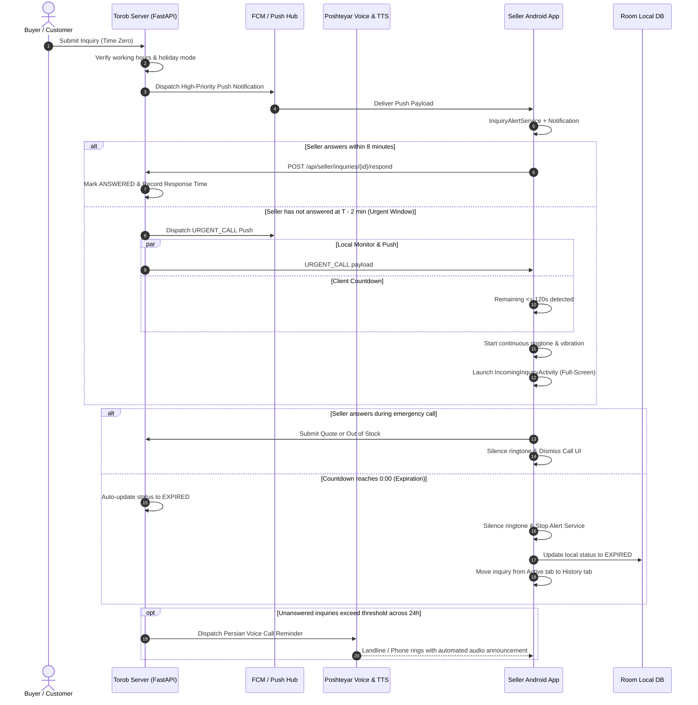

# Comprehensive Web Service & Architecture Documentation: Torob Seller Platform

This document serves as the complete technical specification for all backend REST APIs, data models, authentication flows, inquiry lifecycles, emergency call alarms, shop operating states, outbound Persian voice integrations, and offline synchronization protocols of the Torob Seller Platform.

---

## 1. System Overview & Architecture

The Torob Merchant Platform enables in-person and online merchants to receive instant price and inventory inquiries from buyers, review product specifications, submit live quotes, or report out-of-stock items within strict time limits.

### Core Architectural Components:
1. **FastAPI Backend (Python 3.12)**: Provides business-hours enforcement, inquiry state machine, time-zero and 2-minute urgent dispatch, automated voice reminder evaluations, and push/telephony dispatchers.
2. **SQLite Database (WAL Mode)**: High-performance ACID storage with auto-migration, indexing, and seed data including 41,563 authentic Torob merchant records.
3. **Outbound Voice & Persian TTS Engine**:
   - **Poshteyar Telephony Provider**: Originates outbound calls to landline and mobile numbers.
   - **Persian Text-to-Speech (TTS)**: Poshteyar Announcement API and Google Cloud TTS engines rendering natural Persian speech.
   - **Voice OTP Verification**: Automatically routes landline store logins to voice calls with spoken security digits.
   - **Automated Unanswered Inquiry Reminders**: Evaluates store performance metrics and executes automated voice calls to delinquent stores.
4. **Android Merchant App (Jetpack Compose)**:
   - Modern Material 3 UI with Torob Persian design system and Vazirmatn typography.
   - **Time-Zero & 2-Minute Emergency Ringing**: Full-screen incoming call UI (`IncomingInquiryActivity`), high-priority foreground service (`InquiryAlertService`), and continuous ringtone/vibration (`InquiryRingtoneManager`).
   - **Live Countdown & Auto-Expiration**: Ticking countdown with real-time UI transitions; expired inquiries automatically exit the active list and transfer to the History tab (`EXPIRED`).
   - **Offline Resilience & Idempotent Sync**: Local SQLite cache (Room DB) and sequential sync queue with UUID idempotency keys.
   - Clean UI state: Synced inquiries omit any redundant "ثبت نهایی در سرور" badges.



---

## 2. Authentication & Voice OTP

Merchant authentication supports Iranian mobile numbers (SMS delivery) and Iranian landline store numbers (Outbound Persian voice call delivery).

### 2.1. Request OTP (SMS or Voice Call)
- **Method & Endpoint**: `POST /api/seller/auth/request-otp`
- **Access Level**: Public
- **Description**: Normalizes the phone number. If the number is an Iranian landline (e.g., prefix `021`, `031`, `051`, etc.), it automatically routes the verification code through Poshteyar Outbound Voice Call using Persian TTS. Mobile numbers receive SMS.

#### Request Body
```json
{
  "phone_number": "02176557624"
}
```

#### Successful Response (200 OK) — Landline Voice Call
```json
{
  "success": true,
  "message": "کد تایید به صورت تماس صوتی به خط ثابت فروشگاه شما اعلام خواهد شد.",
  "demo_otp": "72941",
  "delivery_method": "voice_call"
}
```

#### Successful Response (200 OK) — Mobile SMS
```json
{
  "success": true,
  "message": "کد تایید با موفقیت ارسال شد.",
  "demo_otp": "12345",
  "delivery_method": "sms"
}
```

### 2.2. Verify OTP & Obtain Bearer Token
- **Method & Endpoint**: `POST /api/seller/auth/verify-otp`
- **Access Level**: Public
- **Description**: Verifies the 5-digit security code. Automatically links or provisions the merchant account and returns a Bearer access token.

#### Request Body
```json
{
  "phone_number": "02176557624",
  "otp_code": "72941"
}
```

#### Successful Response (200 OK)
```json
{
  "access_token": "token_seller_fda7f0c8",
  "token_type": "bearer",
  "seller": {
    "seller_id": "seller_fda7f0c8",
    "phone_number": "02176557624",
    "shop_id": "shop_51d0c1a6edf81ba759726bab",
    "full_name": "فروشگاه کامپیوتر پایتخت",
    "is_active": true
  }
}
```

### 2.3. Get Authenticated Merchant Profile
- **Method & Endpoint**: `GET /api/seller/auth/me`
- **Headers**: `Authorization: Bearer <token>`
- **Response**: `SellerDto`

---

## 3. Store Operating Profile & Working Hours

### 3.1. Get Store Profile & Operational Status
- **Method & Endpoint**: `GET /api/seller/shop`
- **Headers**: `Authorization: Bearer <token>`
- **Description**: Returns store information along with effective operating status computed based on Tehran local time, working hours (`open_time` to `close_time`), and holiday mode.

#### Successful Response (200 OK)
```json
{
  "shop_id": "shop_51d0c1a6edf81ba759726bab",
  "shop_name": "فروشگاه کامپیوتر پایتخت",
  "address": "تهران، مجتمع کامپیوتر پایتخت، طبقه ۲",
  "phone": "02176557624",
  "is_open": true,
  "open_time": "09:00",
  "close_time": "21:00",
  "accept_inquiries": true,
  "holiday_mode": false,
  "voice_reminders_enabled": true,
  "status_message": "فروشگاه باز است و آماده پاسخ‌گویی به استعلام‌ها می‌باشد."
}
```

### 3.2. Update Store Profile
- **Method & Endpoint**: `PUT /api/seller/shop`
- **Headers**: `Authorization: Bearer <token>`

#### Request Body
```json
{
  "open_time": "09:30",
  "close_time": "21:30",
  "accept_inquiries": true,
  "holiday_mode": false,
  "voice_reminders_enabled": true
}
```

### 3.3. Toggle Open / Closed Status
- **Method & Endpoint**: `POST /api/seller/shop/toggle-status`
- **Headers**: `Authorization: Bearer <token>`

### 3.4. Submit Shop Information Change Request
- **Method & Endpoint**: `POST /api/seller/shop/change-requests`
- **Headers**: `Authorization: Bearer <token>`
- **Description**: Submits shop modifications (e.g., address, phone, name) for admin review.

### 3.5. Get Latest Change Request
- **Method & Endpoint**: `GET /api/seller/shop/change-requests/latest`
- **Headers**: `Authorization: Bearer <token>`

---

## 4. Inquiries Lifecycle, Urgent Window & Expiration

Each inquiry progresses through strict states:
```
ACTIVE ───► ANSWERED (Quote submitted)
       ───► OUT_OF_STOCK (Item unavailable)
       ───► DECLINED (Store cannot process with reason)
       ───► EXPIRED (10-minute timer ended without response)
```

### Timeline Rules:
- **0:00 (Time Zero)**: Customer submits inquiry. Backend dispatches initial push notification to merchant.
- **8:00 (T - 2 minutes)**: Urgent Alert Window begins (`remaining_seconds <= 120`).
  - Backend dispatches high-priority `URGENT_CALL` push.
  - Android client triggers `InquiryAlertService`, continuous ringing, vibration, and full-screen incoming call UI.
- **10:00 (Expiration)**:
  - Backend automatically updates status to `EXPIRED` (`UPDATE inquiries SET status = 'EXPIRED' WHERE status = 'ACTIVE' AND datetime(expires_at) <= datetime(now)`).
  - Client stops ringing (`ACTION_STOP_ALERT`), removes the inquiry from "استعلام‌های فعال", and transitions it to "تاریخچه".

### 4.1. List Inquiries
- **Method & Endpoint**: `GET /api/seller/inquiries`
- **Headers**: `Authorization: Bearer <token>`
- **Query Parameters**:
  - `status`: Optional filter (`ACTIVE`, `ANSWERED`, `OUT_OF_STOCK`, `DECLINED`, `EXPIRED`, or `HISTORY`). If omitted, returns all inquiries for the store.
- **Auto-Expiration Guarantee**: Inquiries with `datetime(expires_at) <= datetime(now)` are automatically updated to `EXPIRED` on-the-fly.

#### Sample Item in Response (200 OK)
```json
[
  {
    "inquiry_id": "inq_80717080cc",
    "tracking_code": "TRB-38698A",
    "shop_id": "shop_51d0c1a6edf81ba759726bab",
    "product_id": "p_test_laptop",
    "product_title": "لپ‌تاپ ایسوس ROG Strix",
    "product_image_url": null,
    "category_name": "لپ‌تاپ",
    "recorded_price_toman": 85000000,
    "customer_name": "رضا محمدی",
    "customer_phone": "09129876543",
    "inquiry_type": "price_and_stock",
    "user_note": "آیا رنگ خاکستری موجود هست و گارانتی اصلیه؟",
    "status": "ACTIVE",
    "created_at": "2026-10-23 16:53:51",
    "expires_at": "2026-10-23 17:03:51",
    "remaining_seconds": 580,
    "decline_reason": null,
    "response_price": null,
    "response_in_stock": null,
    "response_notes": null
  }
]
```

### 4.2. Get Inquiry Details
- **Method & Endpoint**: `GET /api/seller/inquiries/{inquiry_id}`
- **Headers**: `Authorization: Bearer <token>`

### 4.3. Respond to Inquiry (Quote, Out of Stock, or Decline)
- **Method & Endpoint**: `POST /api/seller/inquiries/{inquiry_id}/respond`
- **Headers**: `Authorization: Bearer <token>`
- **Description**: Submits the merchant's live response. Supports idempotency via `client_response_id`.

#### Option A: Submit Price & In-Stock Quote
```json
{
  "client_response_id": "bfa861d8-3dc1-4f18-bb92-0b1a5e783da1",
  "is_in_stock": true,
  "offered_price_toman": 84500000,
  "stock_count": 2,
  "notes": "رنگ خاکستری با ۱۸ ماه گارانتی اصلی آواژنگ موجود است."
}
```

#### Option B: Declare Out of Stock
```json
{
  "client_response_id": "c1f72810-7e39-44ba-813d-9d412809f6b2",
  "is_in_stock": false,
  "offered_price_toman": 0,
  "stock_count": 0,
  "notes": "متاسفانه موجودی تمام شده است."
}
```

#### Option C: Decline Inquiry with Reason
```json
{
  "client_response_id": "e93214da-06f1-4ad9-9941-863a8a07153a",
  "status": "DECLINED",
  "decline_reason": "OUT_OF_WORKING_HOURS",
  "notes": "فروشگاه در حال حاضر تعطیل است."
}
```
*Valid `decline_reason` values*: `OUT_OF_WORKING_HOURS`, `PRICE_CHANGED`, `LOGISTICAL_LIMIT`, `STORE_POLICY`, `OTHER`.

#### Successful Response (200 OK)
```json
{
  "inquiry_id": "inq_80717080cc",
  "status": "ANSWERED",
  "response_time_seconds": 65,
  "is_duplicate": false,
  "message": "پاسخ با موفقیت در سامانه ترب ثبت گردید."
}
```

### 4.4. Batch Synchronize Offline Responses
- **Method & Endpoint**: `POST /api/seller/sync/batch-responses`
- **Headers**: `Authorization: Bearer <token>`
- **Description**: Processes queued responses captured while the Android device was disconnected from the internet.

#### Request Body
```json
{
  "items": [
    {
      "client_response_id": "bfa861d8-3dc1-4f18-bb92-0b1a5e783da1",
      "inquiry_id": "inq_80717080cc",
      "is_in_stock": true,
      "offered_price_toman": 84500000,
      "stock_count": 2,
      "notes": "موجود است",
      "recorded_at_epoch_ms": 1792774000000
    }
  ]
}
```

#### Successful Response (200 OK)
```json
{
  "processed_count": 1,
  "success_count": 1,
  "duplicate_count": 0,
  "results": [
    {
      "client_response_id": "bfa861d8-3dc1-4f18-bb92-0b1a5e783da1",
      "inquiry_id": "inq_80717080cc",
      "status": "SYNCED",
      "message": "ثبت شد"
    }
  ]
}
```

---

## 5. Push Notifications & Device Management

### 5.1. Register Device FCM Token
- **Method & Endpoint**: `POST /api/seller/push/register-token`
- **Headers**: `Authorization: Bearer <token>`

#### Request Body
```json
{
  "fcm_token": "fcm_token_abcdef123456...",
  "device_model": "Xiaomi Redmi Note 12",
  "os_version": "Android 14 (API 34)",
  "app_version": "1.0.0",
  "notifications_enabled": true
}
```

### 5.2. Update Notification Preferences
- **Method & Endpoint**: `PUT /api/seller/push/preferences`
- **Headers**: `Authorization: Bearer <token>`

```json
{
  "notifications_enabled": true
}
```

---

## 6. Outbound Persian Voice Calls & Poshteyar Service

The platform implements automated outbound voice notification workflows powered by Poshteyar and Persian TTS.

### 6.1. Scenarios Supported:
1. **Telephone-Based Landline Login Verification**:
   - Detects Iranian landlines and delivers OTP via Persian voice call.
   - Text Template: Spoken digits separated with pauses for maximum clarity.
2. **Automated Reminders for Stores with Too Many Unanswered Inquiries**:
   - Evaluated periodically by background scheduler.
   - Criteria: Minimum total inquiries (e.g. 10), minimum unanswered inquiries (e.g. 6), minimum unanswered rate (e.g. 60%), cooldown interval (e.g. 24h), maximum calls per day (1).
   - Text Template: Polite notification citing the number of unanswered requests and encouraging the merchant to review active inquiries in the app.

### 6.2. Evaluate Store Voice Reminders (Admin API)
- **Method & Endpoint**: `POST /api/admin/voice-reminders/evaluate`
- **Query Parameters**:
  - `shop_id`: Optional specific store ID. If omitted, evaluates all active stores.
  - `dispatch`: Boolean (`true` or `false`). When `true`, automatically places outbound calls for eligible stores.

#### Sample Response (200 OK)
```json
{
  "evaluated_count": 1,
  "eligible_count": 1,
  "dispatched_count": 1,
  "results": [
    {
      "shop_id": "shop_test_delinquent",
      "shop_name": "فروشگاه نمونه",
      "phone": "02188776655",
      "eligible": true,
      "reason": "تعداد استعلام‌های بدون پاسخ بالاتر از حد نصاب است",
      "total_inquiries": 12,
      "unanswered_count": 8,
      "unanswered_rate": 0.67,
      "time_window": "۲۴ ساعت گذشته"
    }
  ],
  "dispatched_calls": [
    {
      "shop_id": "shop_test_delinquent",
      "call_id": "call_5a109e2b10",
      "provider_call_id": "poshtyar_call_98124",
      "status": "COMPLETED",
      "message": "تماس صوتی یادآوری با موفقیت برقرار شد"
    }
  ]
}
```

### 6.3. Outbound Voice Call Audit Logs (Admin API)
- **Method & Endpoint**: `GET /api/admin/outbound-calls`
- **Description**: Returns all outbound voice call records with delivery status, duration, scenario, and error logs (sensitive OTP digits are strictly omitted).

---

## 7. Store Performance Metrics

- **Method & Endpoint**: `GET /api/seller/metrics`
- **Headers**: `Authorization: Bearer <token>`
- **Description**: Provides performance analytics formatted in Persian.

#### Sample Response (200 OK)
```json
{
  "shop_id": "shop_51d0c1a6edf81ba759726bab",
  "total_inquiries": 78,
  "answered_inquiries": 56,
  "expired_inquiries": 22,
  "active_inquiries": 0,
  "response_rate_percent": 71.8,
  "avg_response_time_seconds": 95,
  "avg_response_time_formatted": "۱ دقیقه و ۳۵ ثانیه",
  "rating_tier": "خوب"
}
```

---

## 8. Admin Control Panel Endpoints

- `GET /admin`: Persian RTL single-page dashboard.
- `GET /api/admin/inquiries`: List all inquiries across all stores with auto-expiration applied.
- `POST /api/admin/inquiries/create-test`: Inject simulated buyer inquiries to test Time-Zero flow.
- `GET /api/admin/push/logs`: Real-time audit log of all dispatched FCM push notifications.
- `GET /api/admin/scheduler/configs`: Get scheduler timeouts (`time_zero`, `urgent_call_threshold`, `expiry_seconds`).
- `PUT /api/admin/scheduler/configs`: Update timeout thresholds dynamically.
- `GET /api/admin/shop-change-requests`: List pending shop information changes.
- `POST /api/admin/shop-change-requests/{id}/review`: Approve or reject shop changes.
