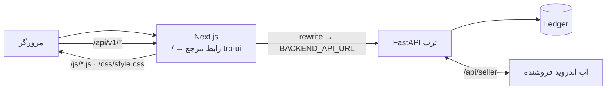

# ترب مپ · TrobApp
### وب‌اپ مشتری: نزدیک‌ترین قیمت، استعلام زنده از فروشنده، و تربچت

> **English summary.** The customer-facing Next.js 14 app for Torob Map. The home route renders the finished **trb-ui** design verbatim — every pixel of the reference prototype — and a thin bridge (`public/js/backend.js`) connects it to the [Torob Intelligence backend](../torob): live merchant inquiries that reach the merchant's Android app and come back with a real answer, and TorobChat over the real 225k-product catalogue.

---

## چه چیزی می‌بینید

| بخش | کار |
|---|---|
| **تربچت** | دستیار خرید گفتگومحور: کارت کالا و فروشگاه، مقایسه، پرسش‌های بودجه/برند/رفت‌وآمد، و برای هر درخواستی خارج از دادهٔ نمونه، جستجو در کاتالوگ واقعی ترب با ارزیابی قیمت، اعتماد فروشگاه و احتمال موجودی |
| **فهرست** | کالا و فروشگاه‌های دارای آن با ترب‌پی، ضمانت، ارسال فوری، امتیاز، مقایسهٔ دو فروشگاه، فیلتر جامع |
| **نقشه** | نقشهٔ واقعی تهران (Leaflet) با پین قیمت، خوشه‌بندی و مسیر برنامهٔ سر زدن |
| **استعلام‌ها** | استعلام‌های زنده: در انتظار ← پاسخ فروشنده (قیمت، موجودی، یادداشت، کد پیگیری) ← انقضای اعتبار |
| **برنامهٔ سر زدن** | چیدن هوشمند توقف‌ها بر اساس فاصله و ساعت بسته‌شدن فروشگاه |

---

## معماری



| مسیر | توضیح |
|---|---|
| `src/app/page.tsx` | نشانه‌گذاری بدنهٔ `trb-ui` (`src/app/uiMarkup.ts`) را عیناً رندر می‌کند |
| `src/app/UiScripts.tsx` | اسکریپت‌های مرجع را به ترتیب صحیح بارگذاری می‌کند (Leaflet ← data ← … ← app ← backend) |
| `public/js/*.js`, `public/css/style.css` | منطق و استایل رابط مرجع (منبع حقیقت طراحی) |
| `public/js/backend.js` | **پل بک‌اند**: استعلام واقعی، نظرسنجی پاسخ فروشنده، تربچت روی کاتالوگ واقعی |
| `next.config.mjs` | پراکسی `/api/v1/*` به `BACKEND_API_URL` (پیش‌فرض `http://127.0.0.1:8080`) — بدون مشکل CORS |
| `/react` | نسخهٔ قبلی بازنویسی React (برای مرجع نگه داشته شده) |

### پل بک‌اند چه می‌کند

- **استعلام:** «ترب برایم استعلام بگیرد» ← `POST /api/v1/customer/inquiries`. فروشگاه‌های دادهٔ نمونه به فروشگاه دموی متصل به اپ فروشنده نگاشت می‌شوند؛ فروشگاه‌های واقعی کاتالوگ (از تربچت) مستقیم استعلام می‌گیرند. هر ۴ ثانیه وضعیت از `GET /api/v1/customer/inquiries` خوانده می‌شود و پاسخ واقعی فروشنده با اعلان نمایش داده می‌شود.
- **تربچت:** پرسش‌هایی که در دادهٔ نمونه نیستند به `POST /api/v1/assistant/sessions/{id}/messages` می‌روند. سؤال‌های تکمیلی دستیار (مثل بازهٔ بودجه) به‌صورت دکمه نمایش داده می‌شوند و پاسخ‌ها در همان گفتگو ادامه پیدا می‌کنند. کارت‌های نتیجه: قیمت در برابر میانهٔ بازار، اعتماد فروشگاه، احتمال موجودی، و دکمهٔ استعلام.
- **صداقت:** اگر بک‌اند در دسترس نباشد، پاسخ شبیه‌سازی‌شده صریحاً با برچسب «نمونه» نشان داده می‌شود؛ هیچ پاسخ فروشنده‌ای جعل نمی‌شود.

---

## اجرا

```bash
# ۱) بک‌اند (پورت 8080)
cd ../torob && ./scripts/run_server.sh

# ۲) فرانت‌اند
npm install
npm run build && npm start          # http://localhost:3000
```

| متغیر محیطی | پیش‌فرض | کاربرد |
|---|---|---|
| `BACKEND_API_URL` | `http://127.0.0.1:8080` | آدرس بک‌اند FastAPI که `/api/v1` به آن پراکسی می‌شود (در زمان build و اجرا) |

### استقرار روی لیارا

این اپ به‌عنوان یک اپلیکیشن Node.js جداگانه روی لیارا مستقر است و با `BACKEND_API_URL=https://torobmap-api.liara.run` به اپ بک‌اند وصل می‌شود.

- وب‌اپ: `https://torobmap.liara.run`
- بک‌اند: `https://torobmap-api.liara.run`

### سناریوی دمو

1. در «فهرست» یک کالا (مثلاً هدفون) را انتخاب کنید ← اطلاعات یک فروشگاه ← «استعلام قیمت» ← «ترب برایم استعلام بگیرد».
2. در اپ اندروید فروشنده (ورود به‌عنوان «فروشگاه جیمبو»: `09120000000`، کد `123456`) استعلام را ببینید و پاسخ دهید.
3. در صفحهٔ «استعلام‌ها» پاسخ واقعی با قیمت، یادداشت و کد پیگیری ظاهر می‌شود.
4. در «تربچت» بنویسید «گوشی سامسونگ زیر ۲۰ میلیون» تا پیشنهادهای کاتالوگ واقعی با شواهد نمایش داده شود.

---

طراحی سیستم و الگوریتم‌ها: [`../torob/README.md`](../torob/README.md) · [`../torob/docs/SYSTEM_DESIGN.md`](../torob/docs/SYSTEM_DESIGN.md)
